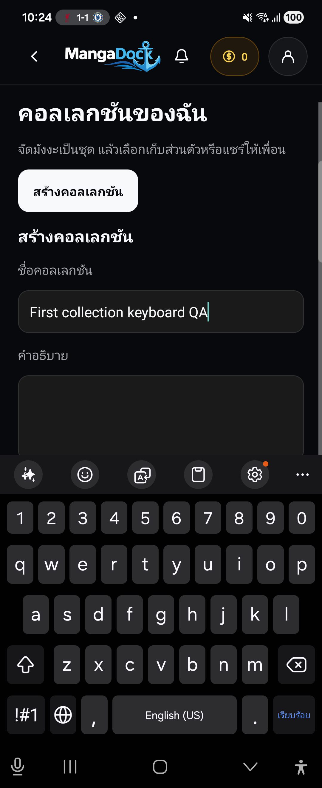
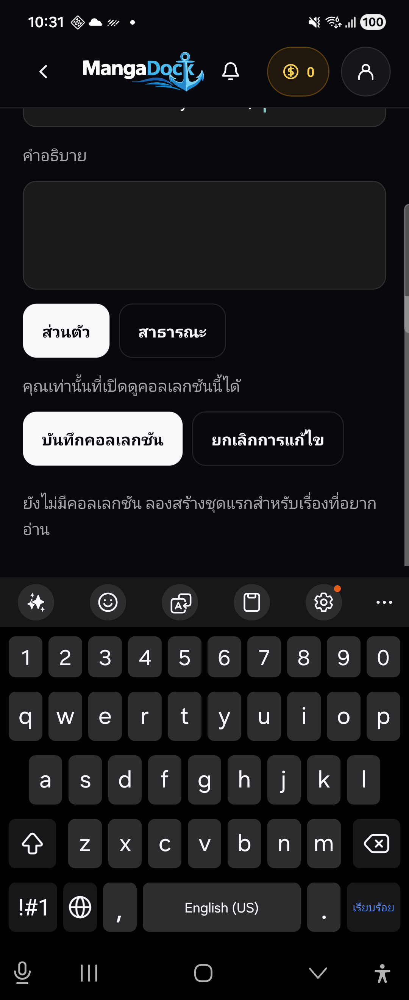

# Native Collections keyboard fix / แก้ keyboard บังปุ่มคอลเลกชัน

## Result / ผลลัพธ์

**K01 fixed and reaccepted on the physical Galaxy Z Flip4, Android 16.** Empty-list Save/Cancel now scroll fully above Samsung Keyboard; saving works without manually dismissing IME. Populated-list multiline create, edit and search/add regressions also pass on the final APK. This closes the observed keyboard defect, not the remaining production Backend/Push/signing gates.

**แก้ K01 และตรวจรับซ้ำบน Galaxy Z Flip4 / Android 16 จริงแล้ว** ขณะรายการคอลเลกชันว่าง ปุ่มบันทึก/ยกเลิกเลื่อนขึ้นพ้น Samsung Keyboard ได้เต็มปุ่ม และกดบันทึกได้โดยไม่ปิดคีย์บอร์ดก่อน ตรวจรายการยาวพร้อมคำอธิบายหลายบรรทัด ฟอร์มแก้ไขและค้นหา/เพิ่มเรื่องบน APK สุดท้ายผ่านด้วย ผลนี้ปิดข้อบกพร่อง keyboard ที่พบ ไม่ใช่การปิดเกณฑ์ production Backend/Push/signing

## Actual before / after / ภาพก่อนและหลังจากโทรศัพท์จริง

Same phone, 1080×2640 px, density 480, portrait, font scale 1.0; both captures use zero collections, the name `First collection keyboard QA`, Samsung Keyboard English (US), and repeated upward form swipes. The screenshots are copied byte-for-byte from ADB captures, with no compositing, retouching, or UI reconstruction. Scroll positions differ because the fixed view can actually scroll above IME. Each image can be opened at its original resolution.

โทรศัพท์เครื่องเดิม ความละเอียด1080×2640, density480, แนวตั้ง ฟอนต์1.0 ทั้งคู่ใช้รายการว่าง ชื่อคอลเลกชันเดียวกัน Samsung Keyboard English (US) และปัดฟอร์มขึ้นซ้ำ ภาพคัดลอกจาก ADB ตรงตาม bytes ต้นฉบับ ไม่ตัดต่อหรือจำลอง UI ตำแหน่งเลื่อนต่างกันเพราะตัวแก้เลื่อนพ้นคีย์บอร์ดได้จริง กดภาพเพื่อดูขนาดต้นฉบับ

| Before / ก่อนแก้ | After final fix / หลังแก้สุดท้าย |
| --- | --- |
|  |  |

| Physical observation / ค่าที่วัดจากเครื่องจริง | Before / ก่อน | Final / หลัง |
| --- | --- | --- |
| Android IME top / ขอบบนคีย์บอร์ด | y=1524 | y=1524 |
| Full Save/Cancel hit boxes / กรอบปุ่มเต็ม | y=1866–2010 | y=1086–1230 |
| Both buttons fully above IME / ปุ่มทั้งคู่พ้นคีย์บอร์ด | FAIL | PASS |
| Save without manually closing keyboard / บันทึกโดยไม่ต้องปิด keyboard ก่อน | Unreachable / เข้าไม่ถึงปุ่ม | PASS |

## Mechanism and minimal change / กลไกและการแก้เฉพาะจุด

Both Collections branches wrapped their FlatList/ScrollView with KeyboardAvoidingView but left Android `behavior` undefined. In installed React Native 0.85.3 that default renders the unadjusted View. With zero collection rows, upward swipes exhaust the short content before the controls clear IME. Long lists masked the issue by supplying more scrollable rows; dismissing IME then saving disproved a Backend/validation cause.

`Mobile/src/NativeRetentionView.tsx` now uses Android `height` behavior for both list/create and detail/edit/search. It supplies the existing safe-area top inset as Android `keyboardVerticalOffset`, because the parent is positioned below the status bar while keyboard coordinates are measured in the screen. The first height-only candidate passed Save but its viewport extended 94 px below IME, matching this phone's top inset; the final offset aligns the viewport with y1524. iOS keeps its existing padding/zero-offset behavior. No dependency, server contract, auth/session, permission or other screen change.

ฟอร์มสองเส้นทางเดิมใช้ KeyboardAvoidingView แต่ Android ไม่กำหนด behavior จึงได้ View ที่ไม่ย่อพื้นที่ตาม implementation ของ React Native ที่ติดตั้ง เมื่อรายการว่างระยะเลื่อนหมดก่อนปุ่มพ้นคีย์บอร์ด รายการยาวเพิ่มระยะเลื่อนจึงกลบปัญหา ส่วนการปิดคีย์บอร์ดแล้วบันทึกสำเร็จหักล้างสาเหตุ Backend/validation

แก้ไฟล์ `NativeRetentionView.tsx` ให้ Android ใช้ `height` ทั้งหน้า list/create และ detail/edit/search พร้อมชดเชย `keyboardVerticalOffset` ด้วย safe-area ด้านบนที่มีอยู่ เพราะ parent เริ่มใต้ status bar แต่พิกัด keyboard อ้างอิงหน้าจอ ตัวทดลองที่เพิ่ม height อย่างเดียวกด Save ได้ แต่ viewport เลยขอบ IME94px เท่ากับ inset ด้านบน จึงใช้ offset จริงในตัวสุดท้าย ฝั่ง iOS คง padding/offset0 ไม่เพิ่ม dependency หรือเปลี่ยน server/auth/session/permission/หน้าจออื่น

## Validation / การตรวจยืนยัน

| Final APK device check / ตรวจบน APK สุดท้าย | Result / ผล |
| --- | --- |
| Zero rows, same typed name and swipes; actual visible IME vs Save/Cancel bounds / รายการว่าง ขั้นตอนเดิม ตรวจกรอบปุ่มเทียบขอบ IME จริง | PASS: y1086–1230 < 1524; native Save creates the record |
| Edit with keyboard open / แก้ไขพร้อม keyboard | PASS: Save/Cancel y807–951; edited name confirmed via fixture API |
| Search and add while keyboard open / ค้นหาและเพิ่มเรื่องพร้อม keyboard | PASS: field y627–771, Search y807–951; native result tap adds 1 item |
| Existing 13-row list, new multiline form / รายการเดิม13ชุด สร้างพร้อมข้อความหลายบรรทัด | PASS: Save/Cancel y392–536; actual saved description matches both lines |
| Fresh Mobile tests / tests ใหม่หลังแก้สุดท้าย | 268/268 PASS |
| TypeScript / ตรวจ types | PASS |
| Real native controller → HTTP → Nest → PostgreSQL fixture integration / integration ผ่าน HTTP/Nest/SQL จริงใน QA แยก | PASS |
| Android ARM64 release + vital lint / build และ vital lint | PASS, 316 tasks, 19 seconds |

Physical regression is in `qa/native-keyboard-fix-20261029/assert-keyboard.cjs`: compare captured accessibility hit boxes against the currently visible IME frame from Android window insets. It failed on the original binary and passes on the final binary. Existing React host mocks cannot reproduce real IME layout, so no prop-only mock test was added as a substitute. The first populated-list probe scrolled past the form into existing rows; scrolling back to the actions produced the passing geometry check. This was a test positioning error, not a product defect.

Regression บนโทรศัพท์ใช้กรอบปุ่มจาก UI จริงเทียบ visible IME frame จาก Android window insets ตัวเดิมล้มเหลว ตัวสุดท้ายผ่าน การ mock React host เดิมไม่จำลอง IME จึงไม่เพิ่ม test ที่ตรวจแค่ค่า prop แล้วอ้างว่าแทนเครื่องจริงได้ การตรวจรายการยาวครั้งแรกเลื่อนเลยฟอร์มไปยังแถวเดิม จึงเลื่อนกลับและตรวจกรอบปุ่มผ่าน แยกข้อผิดพลาดการวางตำแหน่งทดสอบนี้จาก defect ผลิตภัณฑ์

## Artifact, scope and resume / ไฟล์ ขอบเขต และจุดทำต่อ

- Branch `feat/mobile-phase5-push-20261023`, base `5a48595`; source fix and notes local/uncommitted. Historical [initial QA](2026-10-29-native-phase5-device-qa.md) and its original FAIL evidence preserved.
- Final APK: `qa/native-keyboard-fix-20261029/MangaDock-native-phase5-keyboard-final-arm64.apk`; isolated `com.mangadock.mobile.phase5qa`, QA signing, version0.1.0/code1, embedded release JS, Push off. Local and installed SHA-256 match `ce07cdd8572053cc016328ae28b6335e0df043a3d75eea713489916480f6bd99`.
- Before APK SHA-256: `b2dffcdaa4e6895a91c47ba2c487e3824f1db2301e318fa2164c27b13087af4e`. The height-only intermediate is retained separately and is not used for the final After image.
- Exact runtime/views are real native code. Auth/account/catalog are synthetic QA boundaries; retention uses real local Nest/SQL in PGlite. Personal apps/accounts and production services/schema unchanged. No external recipient selected or message sent.
- Performance was not benchmarked. Other Android versions, iOS, tablets, folding, alternative keyboard layouts and production service acceptance are outside this correction's device evidence. Earlier 15 passing scenario groups remain historical results, not a claim that all were rerun on this binary.
- Next: build the regular delivery artifact from this source with the team's real service configuration, then continue production rollout gates separately. No commit/push/merge/deploy performed.
- Cleanup: removed only the temporary QA application and its reverse tcp4017, and stopped only the isolated fixture process created for this fix. Personal apps/data/settings were preserved. Report links and byte-identical before/after screenshot copies verified.

Source fix และบันทึกอยู่ใน branch/เครื่องเดิม ยังไม่ commit/push/deploy เก็บภาพ FAIL และ APK ก่อนแก้ไว้ครบ ภาพ After มาจาก APK สุดท้ายตาม hash ด้านบน ไม่ใช้ตัวทดลอง height-only แทน ข้อมูล Auth/account/catalog เป็น QA แยก ส่วน retention ผ่าน Nest/SQL ในเครื่องจริง ไม่แตะ session ส่วนตัวหรือ production ไม่ส่งข้อความออก ไม่อ้าง performance/อุปกรณ์หรือ keyboard อื่นที่ไม่ได้ตรวจ และไม่อ้างว่ารันทุกรายการจาก15กลุ่มเดิมใหม่ทั้งหมด งานต่อคือ build artifact ส่งมอบด้วย config บริการจริงและตรวจเกณฑ์ rollout แยก
