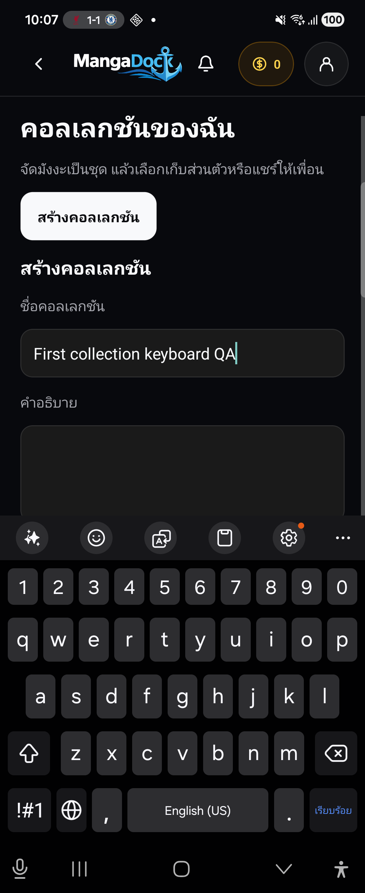
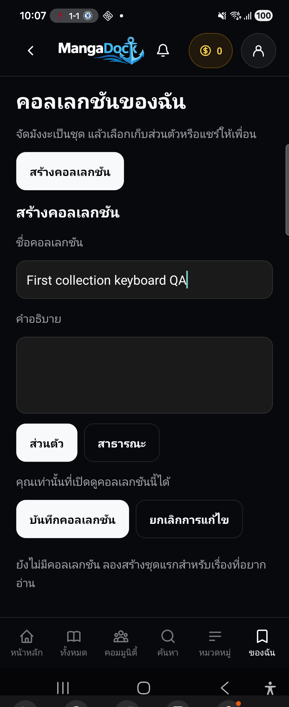

# Native Phase 5 — Galaxy Z Flip4 acceptance, 2026-10-29

**Subsequent authorized fix:** K01 is now fixed and reaccepted on the same physical phone. See [actual before/after screenshots, final APK identity and affected-path regressions](2026-10-29-native-keyboard-fix.md). The original inspection and FAIL evidence below are preserved as history. / **ผลแก้ภายหลัง:** แก้ K01 และรับซ้ำบนโทรศัพท์เครื่องเดิมแล้ว รายงานที่ลิงก์มีภาพจริงก่อน–หลังและ hash APK สุดท้าย ผล FAIL ด้านล่างเป็นประวัติเดิม ไม่ลบหลักฐาน

## Result / ผลตรวจ

**The requested device QA is complete: 15 scenario groups PASS, 1 FAIL. Native keyboard acceptance remains open.** The first-collection form cannot scroll its Save/Cancel controls above Samsung Keyboard when the collection list is empty. Dismissing the keyboard permits saving. No product source fix was applied during this inspection.

**ตรวจเครื่องจริงตามขอบเขตเสร็จแล้ว: ผ่าน 15 กลุ่ม ไม่ผ่าน 1 กลุ่ม ยังปิด acceptance ของ keyboard ไม่ได้** เมื่อยังไม่มีคอลเลกชัน ฟอร์มสร้างชุดแรกเลื่อนปุ่มบันทึก/ยกเลิกขึ้นเหนือ Samsung Keyboard ไม่ได้ ปิดคีย์บอร์ดแล้วบันทึกสำเร็จ รอบนี้เป็นการตรวจและบันทึกข้อบกพร่อง ยังไม่แก้ source ของผลิตภัณฑ์

## Exact target / เป้าหมายที่ใช้จริง

- Source: `feat/mobile-phase5-push-20261023`, commit `5a48595`, `C:/Users/woral/md-phase5-mobile`. Product source remained unchanged.
- Device: Samsung Galaxy Z Flip4 `SM-F721B`, Android 16, physical 1080×2640 px at 480 dpi, portrait, font scale 1.0. Existing authorized Wireless ADB; no pairing reset or personal app data clearing.
- Isolated package: `com.mangadock.mobile.phase5qa`; activity `com.mangadock.mobile.MainActivity`. A Gradle init script changes only the QA application ID. Production namespace, views and product `mangadock://` parser are unchanged. Intent probes explicitly target the QA package, so they prove dispatch/parser behavior rather than the user's default-handler choice.
- APK: `qa/native-device-20261029/MangaDock-native-phase5-isolated-arm64.apk`, version 0.1.0/code 1, ARM64, QA/debug signing, embedded release JS, Push disabled. `assembleRelease` and vital lint passed in 1m51s, 316 tasks.
- Local APK and installed `base.apk` have identical SHA-256: `b2dffcdaa4e6895a91c47ba2c487e3824f1db2301e318fa2164c27b13087af4e`.
- Services: phone `127.0.0.1:4017` through ADB reverse to an isolated loopback fixture. Native production runtime/views call real local HTTP → Nest retention controllers → PostgreSQL migration SQL in PGlite. Auth, account, catalog and post-detail surroundings are synthetic QA boundaries. This is device interaction evidence, not production Backend/Auth/Redis/Push acceptance.

ใช้ source และอุปกรณ์ตามรายการด้านบนจริง APK แยก package จึงไม่ทับแอป/session ส่วนตัว ใช้ release JS ฝังในแอป ไม่ต้องเปิด Metro และปิด Push ไว้ ค่า public configuration ชี้ QA loopback เท่านั้น คำขอ Collections/Feed ผ่าน HTTP, Nest และ SQL จริงใน PGlite แต่ Auth/บัญชี/catalog/ส่วนประกอบรายละเอียดโพสต์เป็นข้อมูลทดสอบ จึงไม่ใช่ผลรับรองบริการ production หรือ provider login จริง ใช้ URI เดิมและส่ง intent ระบุ package QA ชัดเจน ไม่รับรองการเลือก default handler ของโทรศัพท์

## Scenario matrix / ผลแยกสถานการณ์

Evidence identifiers refer to original PNG/XML/JSON files in `qa/native-device-20261029/`; selected original PNGs are copied byte-for-byte into [screenshots](screenshots/native-phase5-20261029/).

| ID | Scenario / สถานการณ์ | Result | Evidence |
| --- | --- | --- | --- |
| D01 | Cold public collection link as guest; no owner controls / ปิดแอปแล้วเปิดลิงก์สาธารณะโดย guest ไม่มีปุ่มเจ้าของ | PASS | 01 |
| D02 | Warm Feed link → guest login → returns to intended Feed / ลิงก์ Feed ขณะเปิดแอป ล็อกอิน QA แล้วกลับ Feed เดิม | PASS | 06–10 |
| D03 | Cold private collection and cold Feed restore QA session / ลิงก์ส่วนตัวและ Feed หลังปิด process กู้ session QA | PASS | 27, 29 |
| D04 | Invalid collection UUID stays on existing valid screen / UUID ผิดไม่เปลี่ยนหน้าจอเดิม | PASS | 27–28 |
| C01 | Create with existing list, multiline description, scroll and save while IME open / มีรายการอยู่แล้ว สร้างและบันทึกข้อความหลายบรรทัดขณะเปิดคีย์บอร์ด | PASS | 17–20 |
| C02 | Search with keyboard action, add manga, duplicate-add control disabled / ค้นหาด้วยปุ่มคีย์บอร์ด เพิ่มเรื่อง ปุ่มเพิ่มซ้ำถูกปิด | PASS | 21–23 |
| C03 | Edit name/visibility with keyboard; description preserved / แก้ชื่อและความเป็นส่วนตัวพร้อมคีย์บอร์ด เก็บคำอธิบายเดิม | PASS | 24–27; fixture API confirms saved fields |
| C04 | Remove item and delete collection: cancel then confirm / ยกเลิกและยืนยัน dialog นำเรื่องออก/ลบคอลเลกชัน | PASS | 31–34; fixture cleanup sees 17 remaining collections |
| C05 | Collection list scroll reaches last seeded and newly created rows / เลื่อนรายการถึงชุดท้ายและชุดที่สร้างใหม่ | PASS | 30 |
| C06 | Public collection detail scroll reaches last of 23 items / เลื่อนรายละเอียดถึงรายการที่ 23 | PASS | 04–05 |
| K01 | Empty-list first form: Save/Cancel must remain reachable with IME / รายการว่าง ฟอร์มชุดแรกต้องเลื่อนปุ่มให้กดได้ขณะเปิดคีย์บอร์ด | **FAIL** | 35–39; finding below |
| F01 | Following/Personalized populated; open post and Back preserves selected mode / Feed สองโหมดมีข้อมูล เปิดโพสต์และ Back คงโหมด | PASS | 10–13; XML selected=true remains on Personalized |
| F02 | Scroll first page, load more, reach final seeded post / เลื่อนหน้าแรก โหลดเพิ่ม ถึงโพสต์สุดท้าย | PASS | 14–15; 36 posts, last title `Native QA post 35` |
| F03 | Pull-to-refresh returns usable rendered Feed / ดึงรีเฟรชแล้ว Feed กลับมาใช้งานได้ | PASS | 40; no claim about remote freshness |
| S01 | Native share sheet has correct name/URI; Back returns to collection / share sheet แสดงชื่อและ URI ถูกต้อง Back กลับคอลเลกชัน | PASS | 02–04; no recipient selected or external message sent |
| A01 | Logout clears Feed; guest private collection denied / ออกจากระบบแล้วล้าง Feed และ guest เปิดส่วนตัวไม่ได้ | PASS | 43–44 |

## K01 — keyboard covers first-collection actions / คีย์บอร์ดบังปุ่มชุดแรก

**Impact:** a first-time user cannot reach Save/Cancel by scrolling with the keyboard open. The workaround is Android Back to dismiss the keyboard, then Save; this does not satisfy the keyboard acceptance criterion.

**Reproduce:** use an account with zero collections → Collections → Create → focus Name → type a name → swipe the visible form upwards, then repeat. On this phone the Save text remains at y=1905–1971 while the keyboard begins near y=1524. Closing IME exposes the same button, and saving succeeds. Filled existing-list data masks the defect because those rows supply enough scrollable content.

**Trace:** `NativeRetentionView.tsx` renders the form as a FlatList header inside KeyboardAvoidingView, with `behavior` set to `padding` only on iOS and `undefined` on Android (around line 408). In the observed Android 16 release, the IME overlays the unshrunk content viewport. With zero rows, swipes exhaust the short content's scroll range. This proves missing usable keyboard avoidance in this configuration; it does not identify an Android/RN framework regression or establish behavior on all Android versions.

**Competing explanations checked:** an input-only swipe target is insufficient because repeated whole-form swipes keep the same Save bounds; a Backend validation/save failure is insufficient because dismissing IME immediately enables a successful save; a general list-scroll failure is contradicted by the 18-row list and 23-item detail observations. The release QA binary is not debuggable; the trace uses unchanged source and device/IME observations, without in-product instrumentation.

**Suggested minimal follow-up:** give the Android form a keyboard-aware viewport/inset so Save/Cancel remain reachable independently of collection count. Verify empty list, populated list, edit form and search field on the same phone. Do not mark K01 fixed from unit tests alone.

**ผลกระทบ:** ผู้ใช้ที่ยังไม่มีคอลเลกชันเลื่อนปุ่มบันทึก/ยกเลิกขึ้นมาไม่ได้ขณะเปิดคีย์บอร์ด ต้องกด Back ปิดคีย์บอร์ดก่อนจึงกดบันทึกได้ จึงยังไม่ผ่านเกณฑ์ keyboard แม้การบันทึกเองทำงาน

**ทำซ้ำ:** บัญชีที่ไม่มีคอลเลกชัน → สร้าง → แตะชื่อและพิมพ์ → ปัดฟอร์มขึ้นซ้ำ ปุ่มยังอยู่ y=1905–1971 ใต้ขอบบนคีย์บอร์ดประมาณ y=1524 ปิดคีย์บอร์ดแล้วกดปุ่มเดิมได้และบันทึกสำเร็จ กรณีที่มีหลายรายการผ่านเพราะรายการด้านล่างเพิ่มระยะเลื่อน จึงกลบปัญหาชุดแรก

**เส้นทาง source:** ฟอร์มอยู่ใน header ของ FlatList ภายใน KeyboardAvoidingView ซึ่งกำหนด `padding` เฉพาะ iOS และปล่อย Android เป็น `undefined` บน Android 16 ที่ตรวจ คีย์บอร์ดทับ viewport ซึ่งไม่ได้ย่อ เมื่อรายการว่างจึงเลื่อนจนสุดก่อนปุ่มพ้นคีย์บอร์ด ข้อสรุปนี้เป็นปัญหาการหลบ keyboard ใน configuration ที่ตรวจ ไม่ใช่ข้อพิสูจน์ว่า framework มี regression หรือ Android ทุกรุ่นเป็นเหมือนกัน

ตรวจหักล้างแล้ว: ปัดซ้ำยังได้พิกัดปุ่มเดิม จึงไม่ใช่แค่แตะตำแหน่งปัดผิด; ปิดคีย์บอร์ดแล้วบันทึกสำเร็จ จึงไม่ใช่ validation/Backend ปฏิเสธ; รายการยาวเลื่อนได้ จึงไม่ใช่ระบบ scroll ทั้งหมดเสีย Binary release ไม่เปิด debugging จึงใช้ source และพฤติกรรม IME โดยไม่แทรกโค้ดทดลอง ควรแก้ viewport/inset ฝั่ง Android แล้วตรวจซ้ำทั้งรายการว่าง รายการยาว ฟอร์มแก้ไข และช่องค้นหาบนโทรศัพท์เดิม

## Validation, limits and resume / ผลตรวจ ข้อจำกัด และจุดทำต่อ

- Fresh Mobile **268/268**, TypeScript and `node scripts/phase5-native-integration.cjs` pass. Source tests did not catch K01. The current-process filtered logcat sample matched zero fatal/JS-error lines; it is not a lifetime crash guarantee.
- Captures are real physical-device screenshots. PNG and UI XML are sequential, not atomic; use the PNG for actual keyboard visibility because UIAutomator can expose nodes behind IME. Capture 29 occurred during startup; settled Feed evidence is 10/11/40.
- Helper corrections: Samsung multi-display screencap writes a warning before PNG bytes on stdout, so the first screenshot's 347-byte transport prefix was removed without changing PNG image data; original stdout bytes remain alongside it. Later captures use device-file/pull and an explicit main-display ID. Initial resumed-activity matching was updated for `topResumedActivity`. An initial public-collection host probe incorrectly used the authenticated route and got 401; the correct `/collections/public/:id` returned all 23 items. Samsung Pass briefly appeared for dummy QA login; its dialog is not counted as Feed acceptance and no save action was selected.
- QA data included 36 posts, 17 seeded collections and 23 public items. Creating/editing/removing data touched only isolated fixture records. The fixture collections were subsequently emptied specifically to test K01. Real accounts, provider settings, production data/schema, Push and distribution are outside this run.
- Real cloud service connectivity, remote Push, real-account switching/token expiry, performance, font scaling other than 1.0, tablet/iOS, external-recipient delivery and HTTPS app links remain untested here. The share URI requires an installed app.
- All notes remain local; no commit, push, merge, deployment, remote issue/comment or provider change. Next: fix and reaccept K01 before closing native keyboard acceptance; retain separate production rollout gates from the 24 October delivery record.
- Cleanup completed: uninstalled only the temporary `com.mangadock.mobile.phase5qa` application, removed only the QA-created reverse tcp4017, and stopped the known isolated fixture process. Personal apps and settings were preserved. APK, 44 original capture pairs and 14 byte-identical selected screenshot copies remain local; all report links and PNG dimensions were verified.

ตรวจใหม่ผ่าน Mobile 268/268, TypeScript และ integration HTTP/Nest/SQL แต่ tests เหล่านี้ไม่จับ K01 ภาพเป็นเครื่องจริง PNG/XML ถ่ายต่อกันจึงไม่ใช่เวลาเดียวกัน โดยเฉพาะ XML ยังเห็นปุ่มใต้ keyboard ให้ใช้ PNG ตัดสินการมองเห็น ข้อผิดพลาดของ helper/คำสั่งตรวจข้างต้นบันทึกแยกจาก defect ผลิตภัณฑ์ ข้อมูลทั้งหมดเป็น QA แยก ไม่ใช้บัญชีจริง ไม่ส่งข้อความออก ไม่เปลี่ยน production/schema/provider ไม่ commit/push/deploy หลังตรวจถอนเฉพาะแอป QA คืน reverse4017 และหยุด fixture ที่สร้างรอบนี้ เก็บAPK/44ภาพต้นฉบับ/14ภาพคัดลอกไว้ในเครื่อง ตรวจลิงก์และภาพครบ งานต่อคือแก้และรับ K01 บนเครื่องเดิม ส่วนบริการจริง Push signing อุปกรณ์อื่นและเงื่อนไข release ยังแยกค้างตามรายงานเดิม
