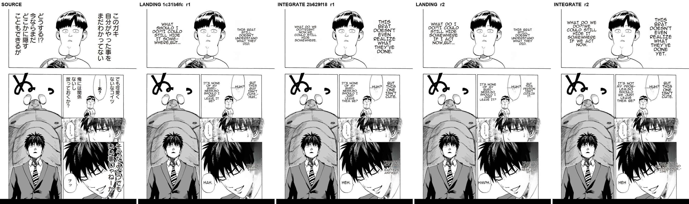
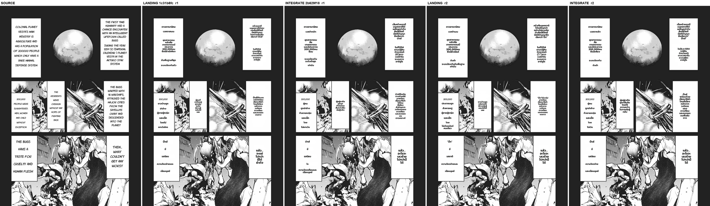

# #642 Phase E translation-quality gate — integrate vs landing baseline

- **Date:** 2026-10-20 · **PR:** #642 · **Epic:** #626 / #548
- **Compared:** baseline `landing/render-phase0` tip **`1c31b6fc`** (the commit merged into integrate; descendant of best-render `9ce97b85`, differs only in Flux code, unused here) vs **`integrate/render-reconcile` @ `2b629f18`** (after the 2026-10-20 catch-up merge of `main` + #693).
- **Gate (RECONCILIATION-PLAN §Phase E):** integrate's translated text must be **equal-or-better** than baseline — no dropped/garbled bubbles, index alignment, no romaji leak, no empty content.
- **Verdict owner:** the dev. This report records what was observed; it does not self-certify a PASS (translation is non-deterministic and quality is a human call).

## Method

- Harness: `MIT/tools/bench_translation_gate.py` — in-process `MangaTranslator`, one Python process per MIT tree, same tuned `Config` on both sides (copied from `tools/bench_render_tuned.py`: `lama_large`, full-page inpaint, `bubble_area_fit`, `det_bubble_seg`, `det_sfx`, `vlm_rescue`, supersampling 4, uppercase, KP off, Flux off). `Backend/.env` is not involved — both sides run the identical in-process config, so the comparison is fair by construction.
- LLM: `custom_openai` via the configured gateway (`qwen3.6-35b-a3b`), thinking off (both sides read the same `MIT/.env`).
- GPU: RTX 5060 Ti (`CUDA_VISIBLE_DEVICES=1`). Model weights junctioned from the main checkout.
- Pages (full-res, multi-region): `MIT/tools/_bubble_proof/benchmark_before.png` (One-Punch, JP→**ENG**, 800×1150) and `MIT/tools/_bubble_proof/before.png` (EN captions →**THA**, 1200×1705).
- **N = 2 runs per page per side** (8 runs). Per-region `text / translation / xyxy` dumped to JSON.

## Result — categorical criteria

| page | side | runs | regions | empty | index-aligned | romaji / Latin in TH | dropped vs other side |
|---|---|---|---|---|---|---|---|
| One-Punch JP→ENG | landing | 2 | 7, 7 | 0, 0 | yes | n/a | — |
| One-Punch JP→ENG | integrate | 2 | 7, 7 | 0, 0 | yes | n/a | none (same 7 boxes, same `xyxy`) |
| EN→THA | landing | 2 | 21, 21 | 0, 0 | yes | 0, 1 (`(IC)`) | — |
| EN→THA | integrate | 2 | 21, 21 | 0, 0 | yes | 1 (`(IC)`), 0 | none (same 21 boxes, same `xyxy`) |

- Detection + OCR are **identical** across sides (same region count and boxes on every run) — integrate does not drop or add bubbles.
- No empty translation on either side in 8 runs. `(IC)` is the source's own abbreviation, not a romaji leak.
- Wording differs run-to-run **within** each side about as much as **between** sides (e.g. `HAH.` / `HMPH.` on landing vs `HEH.` / `HEH` on integrate) — consistent with sampling non-determinism, not a systematic change.

## Pre-existing defects seen on BOTH sides (not regressions — the next quality work)

1. **Caption boxes split per line → fragmented Thai (largest usability hit).** The left caption ("COLONIAL PLANET / VESTA'S MAIN / …") and "THE BUGS / HAVE A / TASTE FOR / …" are detected as one region per line (5 + 5 regions), each translated separately. Thai comes out choppy, a proper noun is mangled (`VESTAS MAIN` → `เวสตาสเมน` / `เวสต้าหลัก`), and meaning shifts between fragments (`CRUELTY AND` → `ใน`, `HUMAN FLESH` → `ความโหดเหี้ยมและเนื้อมนุษย์`). Textline-merge granularity, upstream of translation; identical on landing.
2. **One-Punch bottom-right dialogue over dark hair** renders low-contrast and hard to read on both sides.
3. **`ぬ` display-SFX stays untranslated** on both (not detected as a region in these runs; the rescue is unserved on this model anyway — see #693 / #754).
4. The `200,000` caption line is not detected on either side; the original numerals remain (harmless).

## Defect checklist (8-point, `feedback_benchmark_defect_checklist`)

| check | landing | integrate |
|---|---|---|
| empty bubble | none | none |
| text too small | captions OK; One-Punch top-left small on some runs | same |
| garbled | fragment-level Thai (defect 1) | same |
| fade | none seen | none seen |
| multi-lobe | n/a on these pages | n/a |
| romaji | none | none |
| overlap | none | none |
| clipped | none | none |

## Reading

On these two pages integrate reproduces the baseline's translation behaviour: same regions, no empties, no misalignment, no romaji; differences are sampling noise. **Awaiting dev confirmation of the gate from the PNGs above.** Separately, defect 1 (per-line caption splitting) is the clearest lever for "usable in practice" Thai output and should be filed as its own issue after Phase E.
