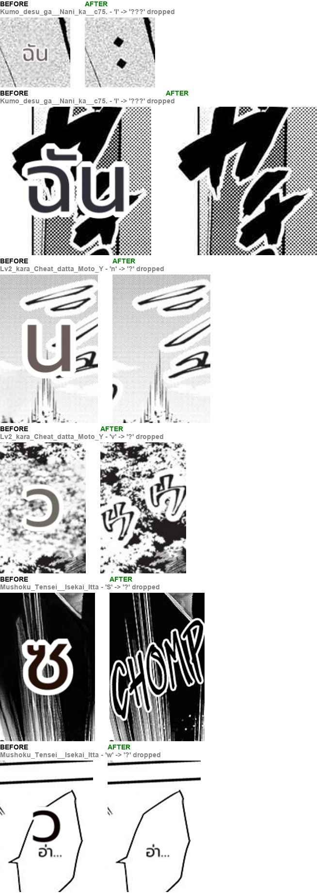

# #754 + #797 junk-read drop (and #796, reverted) — deterministic replay A/B

- **Date:** 2026-10-20/21 · **Issues:** #754 (det_sfx false-positive DROP), #797 (rescue placeholders); #796 (2-line merge) was shipped, then **reverted** after code review — see below
- **Before:** `911dd753` · **After:** `07051fd2` — prod font + prod render knobs, EN corpus (16 pages) → THA. Both arms ran the same doctor (`--replay` covering the batch retry and texts the recording dropped as identical), so they differ only by pipeline code.
- **Defect tied to:** a stray one-letter OCR read of art or of a whole balloon, translated and drawn as a huge Thai glyph — `w → ว` over `อ่า...`, `I → ฉัน` over SFX art, `n → น`, `v → ว`, `S → ซ` over the `CHOMP` lettering.

## The rule, and why not main's

A probe over the corpus logged every det_sfx box and every rescue placeholder with its OCR read.
Every junk read was **one ASCII character** (`I`, `v`, `n`, `S`, `1`, `w`, `V`, `7`). Multi-character
ASCII reads were real lettering — `CHAINSAWMAN`, `Yamai`, `Omake`, `491`, `LEAK OUTSIDE`, `TO CHECK` —
which `main`'s blanket "any real-text read" DROP would also throw away.

Dropped: a region whose **every** line is a detector guess (det_sfx box or empty-balloon /
ink-cluster placeholder — `TextBlock.speculative`) when its read is one ASCII char, or real text lying
**more than half inside** a dialogue line (a fragment of it, like `THE` on a Gal Yome bubble). Code
review tightened two things: a real line merged with a det_sfx fragment is never speculative, and a
big SFX that merely surrounds a small line is kept.

## Result

| | before | after |
|---|---|---|
| junk one-letter regions rendered | 6 (`I` ×2, `n`, `v`, `S`, `w`) | **0** |
| other regions | — | identical, except one text the recording never saw (`HOW DO I CALL I OUT?`, Lv2 p1) that both arms translated live |
| overlapping rendered pairs (doctor) | 3 | 2 |
| real multi-char lettering | kept | kept |

`S` was a real SFX (`CHOMP`): dropping it shows the original English lettering instead of a
meaningless `ซ`; translating it needs the VLM rescue, which the current gateway model cannot serve
(#771). One-Punch (`ぬっ`, the `X` row #754 names): `ぬっ` stays untouched in both arms of the
2026-10-20 JP→EN run (`2026-10-20-792-en-target-onepunch.png`). The Gal Yome pages #754 lists are not
on this machine; their one-letter reads (`W`, `I`, `M`, `8`, `1`) fall under the rule, `THE`/`WHA`
only if they lie inside a dialogue line — not re-verified here.

## #796, reverted

Raising the 2-line split limit from 1.5× to 2× the font merged the Chainsaw p0 credit sentence, but
review showed every aligned pair the merge gate admits (gap < 1 font) already has a pitch under ~2×,
so the split never fired and genuinely separate stacked captions would merge. The only measured gain
was one scanlator-credits page — a tradeoff without evidence, so it is not shipped (#796 stays open).
