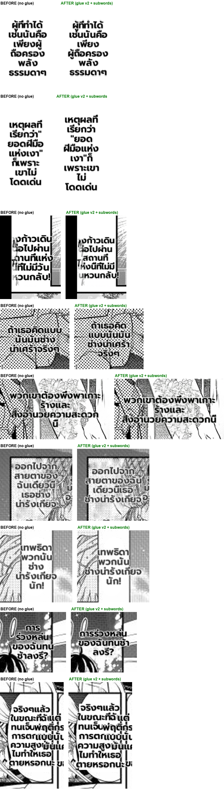

# #759 Thai line breaks — glue rules + atomic words + compound sub-segmentation (replay A/B)

- **Date:** 2026-10-20 · **Issues:** #759 (glue rules), #761 (fit — the golden that caught mid-word splits)
- **Before:** `c3693126` with the glue commit reverted (no glue) · **After:** `8a31bb61` + `74817c62` (glue incl. demonstratives, atomic Thai words, dictionary sub-words for over-wide compounds)
- **Defect tied to:** lines ending on a bound prefix (`การ` / `ผู้`), a demonstrative starting a line (`พวก / นั้น`), a quote stranded at a line end, and a Thai word broken mid-word (`เวลาเดี / ยวกัน`).

## Method

Pipeline Doctor `--replay` over the EN corpus (THA target, production patches path): both arms
replay the same recorded translations, so only the line-breaking code differs. Every region whose
`dst_box` changed while its translation was identical is cropped above (left = before, right =
after).

## Result

| | count |
|---|---|
| regions with identical translation | 179 |
| layout changed | 6 (first glue round) / 9 (final, crops above) |
| font size changed | **0** |
| doctor render spill | 7 → 7 |

Read as a Thai reader, per crop: `เพียงผู้ / ถือครอง` → `เพียง / ผู้ถือครอง` ✅; quote stranded at a line
end → attached ✅; `สายตาของ / ฉัน…` → `สายตาของฉัน` ✅; `การ / ร่วงหล่น` → `การร่วงหล่น` ✅; the
first-round regression `เทพธิดาพวก / นั้น` → `เทพธิดา / พวกนั้น` ✅ (demonstrative rule). Neutral:
`ยอด / ฝีมือแห่ง`, `ช้า / ลง` — still newmm token boundaries; the glue removes bad break options but
the reflow can land on another acceptable-but-not-ideal one.

The fixture golden `resize_regions_thai` (31 → 38 px after #761) now lays out `น่ารักในเวลา /
เดียวกันเลยนะ` instead of the mid-word `น่ารักในเวลาเดี / ยวกันเลยนะ`.

## Not solved here

Transliterated names absent from the dictionary are still over-segmented (`เวส|ตา`) — needs a
`custom_dict` from the series glossary. Visible spaces in Thai are still dropped (ZWSP breaks).
