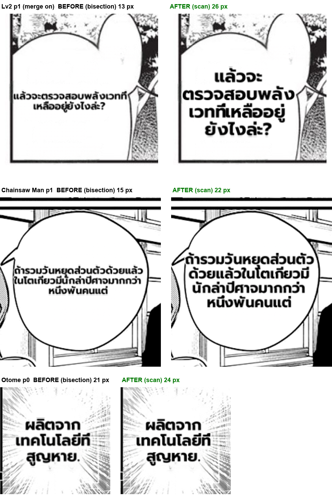

# #761 bubble fit — scan instead of bisection (deterministic replay A/B)

- **Date:** 2026-10-20 · **Issue:** #761 · **Branch:** `feat/mit-quality-loop`
- **Before:** `d6400c02` (bisection) · **After:** `f06ba244` (descending scan + area cap)
- **Defect tied to:** a sole-occupant balloon rendered far smaller than it fits (Lv2 p1: 13 px where 26 fits).

## Method

Pipeline Doctor page mode with `--replay` (#756): both arms replay the translations recorded by an
earlier live run (`*_mfalse.doctor.json`), so only the render code differs. 17 pages (16 MangaDex EN
pages over 8 series + the EN caption page), THA target, tuned in-process config, `translate_patches`
(production path). Regions matched by source text + box. A few texts per page were unseen by the
recording (OCR text differs run to run) and went to the live translator — those regions are
excluded from the comparison because their translation differs between arms.

## Result

| | count |
|---|---|
| regions compared | 182 |
| changed with **identical** translation | 2 — both `bubble_fit_sole`, both **bigger** (15→22, 21→24) |
| changed with a different translation (live confound, excluded) | 4 (`bubble_fit_tall` / `clean_layout`, not touched by this fix) |
| regions that got smaller with identical translation | **0** |
| doctor `composite` failures | 0 → 0 |
| doctor `render` spill | 7 → 8 — the +1 is the confounded `HOW DO I CALL I OUT?` (longer live translation, `bubble_fit_tall`) |

The Lv2 13 px case (merge on, replayed) → **26 px**: the text now fills the balloon instead of a
two-line strip that crossed the left edge.

## Root cause recap

`calc_horizontal` can return lines wider than the `max_width` it was given (162 px at size 21 vs a
150 px limit), so "fits" is not monotonic in size: {…13, 16, 18, 19, 23, 24, 26}. Bisection turned
at 20 and returned 13. The scan returns the largest fitting size; `area_font_cap` bounds the scan
to a handful of measures (6–24 ms per region).

## Follow-up (not in this change)

The wrapper overshooting `max_width` is itself a defect (the deeper cause of the non-monotonic fit);
fixing it would let more sizes fit. Tracked as a note on #761.
