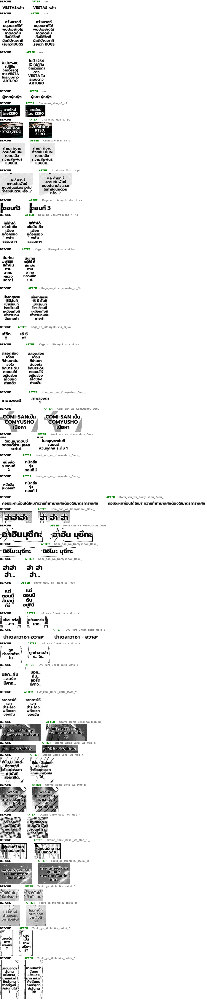

# #791 + #792 Thai spaces kept, punctuation keeps its space (replay A/B)

- **Date:** 2026-10-20 · **Issues:** #791 (Thai spaces kept), #792 (space after punctuation deleted in every language), plus the code-review fixes in `a942dede` (#759/#761 follow-ups)
- **Before:** `faad74c8` (spaces dropped — ZWSP-only breaks) · **After:** `a942dede`
- **Defects tied to:** visible spaces missing in Thai (`VESTASหลัก`, `ผู้ชายผู้หญิง`, `โดยZERO`); `RTSD / ,ZERO` — a comma starting a line (Chainsaw Man c3 p0 credits); `ใบอนุญาตขับขี่รถ / ยนต์` — a compound cut mid-word once a kept space rode on it.

## Method

Pipeline Doctor `--replay` over the EN corpus (17 pages, THA target, production patches path).
Both arms replay the same recorded translations, so only the rendering code differs. The PNG has
every region whose `dst_box` or font changed while its translation was identical, left = before,
right = after. Five very tall regions (big SFX/caption boxes whose visible text did not change)
are left out of the sheet (`MAXH=260`).

## Result

| | count |
|---|---|
| regions with identical translation | 177 |
| layout changed | 46 |
| font size changed | 5 |
| doctor render spill | 7 → 7 |

Read per defect:

- Spaces the translator wrote are visible again: `VESTASหลัก` → `VESTAS หลัก`, `ผู้ชายผู้หญิง` → `ผู้ชาย ผู้หญิง`, `โดยZERO` → `โดย ZERO`, `เรียกว่าBUGS` → `เรียกว่า BUGS` ✅
- `RTSD,ZERO` (comma glued, then split as `RTSD / ,ZERO` in the #791-only arm) → `RTSD, / ZERO` ✅ — the root cause was `compact_special_symbols` deleting the space after `,` before wrapping (#792). The same rule rendered English `Well, I think so! Yes.` as `Well,I / so!Yes.`; that is fixed for every Latin target too (unit test; no EN corpus replay in this report).
- `ขับขี่รถ / ยนต์` (#791-only arm) → `ขับขี่ / รถยนต์ / ส่วนบุคคล` ✅ — the trailing space had made the dictionary split fail.

## Tradeoffs seen

A kept space can cost a line: the credits box goes from 2 to 3 lines (`จัดหน้าโดย / RTSD, / ZERO`) and stays inside its container (spill unchanged). Thai text is still wrapped at newmm word boundaries, so some breaks are acceptable rather than ideal (`ด้วยเรือรบ 16 / ลำ`).

## Found while checking the crops

Tone marks over an upper vowel were missing in **both** arms (`ตอนนี้` → `ตอนนี`, `ขับขี่` → `ขับขี`). That is a separate renderer defect with the prod font, fixed in #793 — see `2026-10-20-793-thai-tone-marks.md`.
