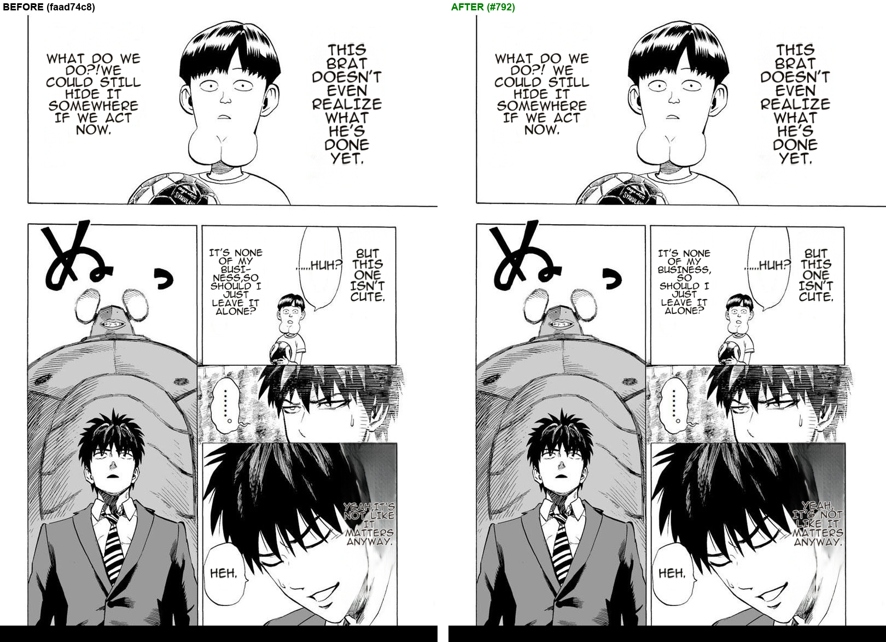

# #792 English target — space after punctuation (One-Punch JP→EN, replay A/B)

- **Date:** 2026-10-20 · **Issue:** #792
- **Before:** `faad74c8` · **After:** `97edd1a3` — the after arm translated live (JPN source only, as the Backend sends it) and the before arm replayed those exact translations
- **Defect tied to:** `compact_special_symbols` deleted every space after punctuation before wrapping, so English rendered `Well,I` / `so!Yes.`

## Result

7 regions, identical translations, identical boxes and font sizes; only the text inside changed:

| before | after |
|---|---|
| `WHAT DO WE DO?!WE COULD…` | `WHAT DO WE DO?! WE COULD…` |
| `IT'S NONE OF MY BUSI-NESS,SO SHOULD I…` | `IT'S NONE OF MY BUSINESS, SO SHOULD I…` (no forced hyphenation either — `BUSINESS,SO` was one long word) |
| `YEAH,IT'S NOT LIKE…` | `YEAH, IT'S NOT LIKE…` |

Every comma and `?!` in an English bubble was glued to the next word in production. Not changed
here: the `ぬっ` SFX stays untranslated (VLM rescue unserved, #771), and the white `YEAH, IT'S…` text
over dark hair is still low-contrast (noted in the #642 gate report).
