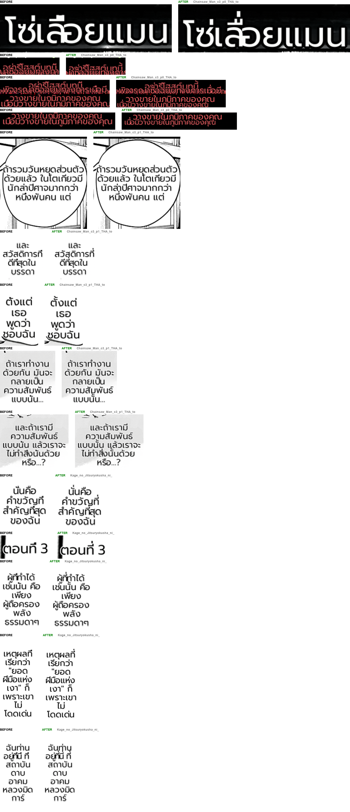

# #793 Thai tone marks over an upper vowel — replay A/B with the prod font

- **Date:** 2026-10-20 · **Issue:** #793
- **Before:** `a942dede` · **After:** `dbc6b4b0` — both arms render with `Prompt-Regular.ttf`, the prod default (`mode/share.py`)
- **Defect tied to:** a tone mark drawn inside the upper vowel or sara am, so it vanished: `ที่ → ที`, `นี้ → นี`, `ตั้งแต่ → ตังแต่`, `โซ่เลื่อยแมน → โซ่เลือยแมน`, `น้ำ` with the tone fused into the nikhahit.

## Method

Pipeline Doctor `--replay` over the EN corpus (16 pages, THA target, production patches path), so
both arms use the same recorded translations and differ only in the renderer. The sheet shows the
first 14 dialogue-sized regions whose translation contains an upper vowel followed by a tone mark,
or a tone mark before sara am, cropped at 2x (left = before, right = after).

## Result

| | count |
|---|---|
| regions with identical translation | 156 |
| regions holding a stacked mark | **66 (42%)** |
| stacked marks in them | 138 |
| dst box changed / font size changed | 2 / 2 |
| doctor render spill | 7 → 7 |

Every stacked mark in the sheet is visible after the fix: `โซ่เลื่อยแมน` (series title), `ตั้งแต่`,
`ที่สุด`, `นั่นคือ`, `ตอนที่ 3`, `เหตุผลที่`, `ผู้ที่`. Before, each of them read as a different or
misspelled word. The lift is measured from the two glyph bitmaps, so a font that already sets the
tone high (Arial — the render goldens) is byte-identical.

## Root cause

Prompt sets the tone at the vowel's height (60 px: `ี` top 48, `่` top 47) and relies on OpenType
GPOS mark-to-mark positioning. The renderer draws glyph by glyph with FreeType and does no shaping,
so nothing lifted it. A full fix would be shaping (HarfBuzz); this change covers the two Thai
stacks that made words unreadable and leaves the rest of the renderer alone.

## Not solved here

- Tall consonants (`ป ฝ ฟ ฬ`) should shift an upper mark left (also GPOS) — the marks are visible,
  so this is cosmetic.
- Chainsaw Man c3 p0: the red credit lines overlap each other in both arms — a layout defect,
  separate from this fix.
