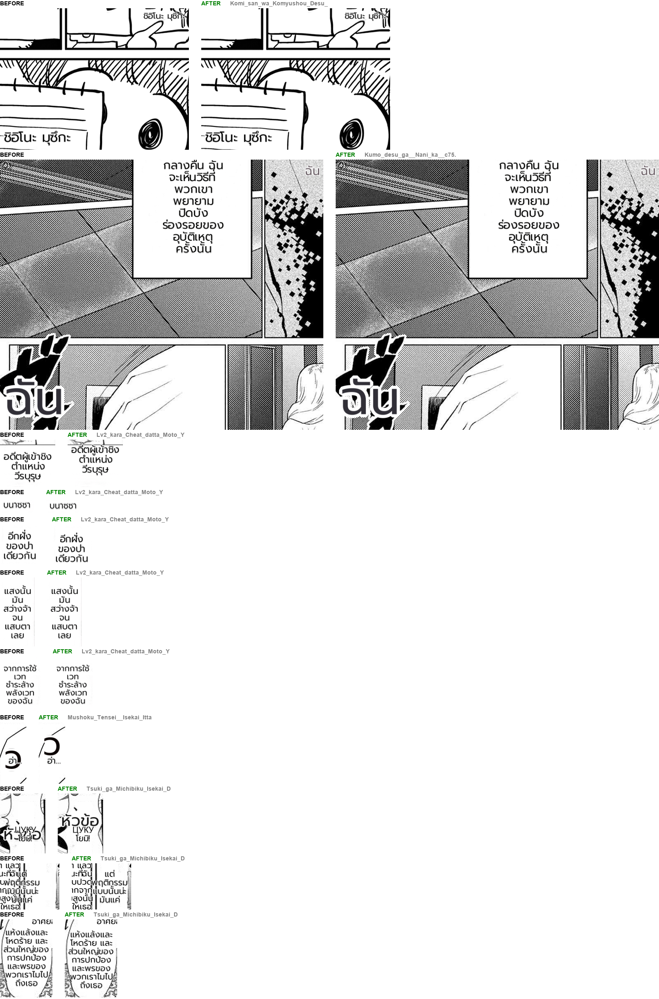

# #795 Anti-overlap keeps a region inside the balloon it shares (replay A/B)

- **Date:** 2026-10-20 · **Issue:** #795 (found by the new Pipeline Doctor overlap verdict, #756)
- **Before:** `dbc6b4b0` · **After:** `911dd753` — both with the prod font and prod render knobs (`anti_overlap`, `clean_layout`, `font_size_max=20`)
- **Defect tied to:** Tsuki ga Michibiku c2 p1 — `BUT THAT SORT OF BEHAVIOR IS JUST` was pushed out of its balloon onto `ACTUALLY, WHILE I HURT…` in the next balloon; both lines unreadable.

## Method

Pipeline Doctor `--replay` over the EN corpus (16 pages, THA target): identical recorded
translations, only the renderer differs. Overlap = two rendered blocks sharing more than 15% of
the smaller block's area (the doctor's new `render` verdict).

## Result

| | before | after |
|---|---|---|
| overlapping rendered pairs (corpus) | 5 | **4** |
| Tsuki p1 balloon collision | yes | **gone** |
| regions re-laid out (identical translation) | — | 11 / 158 |
| font size changed | — | 2 |
| doctor render spill | 7 | 7 |

The Tsuki block is back inside its own balloon. The other changed regions (Lv2, Komi, Kumo) are
regions sharing a balloon that are now centred on their own text instead of being shifted by the
shared balloon — same lines, slightly different position.

## Still overlapping (not this defect)

- **Chainsaw Man c3 p0 (2 pairs):** 9 px credit lines rendered at the fixed 20 px clean-layout
  font, and the two lines of one sentence are split into separate regions (`split_text_region`
  measures line pitch against cap height). Separate follow-up.
- **Mushoku p0 (1 pair):** a det_sfx false-positive read as `w` → `ว` at 84 px over `อ่า...` —
  the missing ADR 026 DROP, #754.
- **Tsuki p1 `、題` (1 pair):** Japanese text on an English page; prod filters it with
  `source_lang_only`, the doctor run did not (`--source ANY`).
