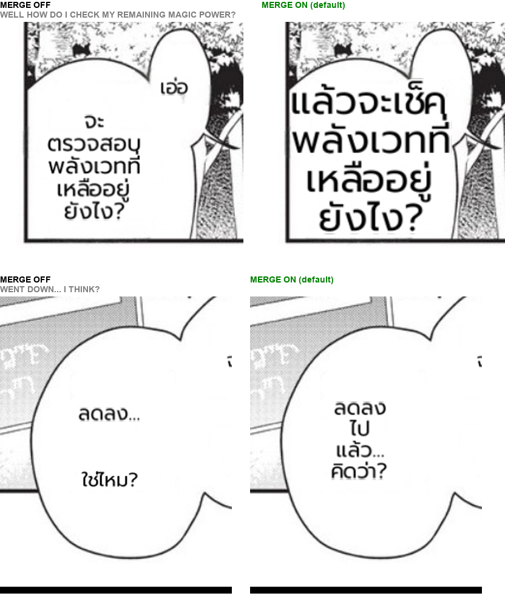

# #757 Container merge on by default — deterministic replay A/B

- **Date:** 2026-10-21 · **Issue:** #757 · **Commit:** `85041003`
- **Arms:** the same code, only `detector.det_bubble_merge` differs (false / true); EN corpus (16 pages) → THA, prod font and knobs, deterministic doctor replay.
- **Defect tied to:** lines of one balloon/caption spaced 1.0–1.7× their font were translated as separate fragments (`WELL` / `HOW DO I CHECK…`), so the sentence was split into stubs and each stub was sized on its own.

## Result

| | off | on |
|---|---|---|
| split containers (doctor `merge`) | 3 | **1** |
| regions | 149 | 148 |
| render spill | 7 | 7 |
| overlapping rendered blocks | 2 | 2 |

Both merges are correct sentences: Lv2 `WELL HOW DO I CHECK MY REMAINING MAGIC POWER?` now renders
as one block at a larger font instead of `เอ่อ` + a separate block, and `WENT DOWN... I THINK?` is one
line group. The merged texts were translated live (they are new texts to the recording), so their
wording varies run to run; layout is what this A/B measures. Earlier evidence: 17 pages, 0 wrong
merges, a caption page 21 → 8 regions. Requires `det_bubble_seg` (prod sets `MIT_BUBBLE_SEG=1`).

Seen on the way, not this change: a Komi rescue placeholder read as `LIt` (3 junk chars) survives the
#754/#797 one-char drop and can render `ไลท์` — follow-up.
