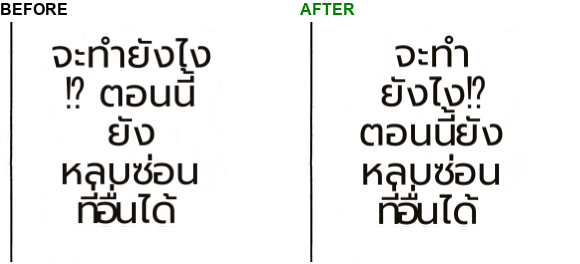

# #759 Full-width marks never start a line; auxiliary glue tried and rejected (JP→TH replay)

- **Date:** 2026-10-21 · **Issue:** #759 · page: One-Punch JP→TH (live recording, then replayed)
- **Defect tied to:** `จะทำยังไง / ⁉ ตอนนี้` — `⁉` (and `‼ ⁈ ⁇ ！ ？ 、 。`) were not in the closer set, so a line could start with them.

## Result (shipped)

`⁉ ‼ ⁈ ⁇ ！ ？ 、 。` bind back like `, . ! ?`. On the page: `ยังไง⁉` on one line; every region's font
size unchanged (39/35/20/26/25/22/30 px before and after).

## Tried and rejected: binding negation / pre-verbal auxiliaries forward

The same page also breaks after `ไม่` / `จะ` / `ยัง` (`ไม่ / เกี่ยวกับ`, `ฉัน จะ / ปล่อยมัน`). Gluing
`ไม่ จะ ยัง กำลัง ต้อง ควร อย่า` to the next word fixed those breaks, but the longer unbreakable
units cost font size in the narrow vertical-JP footprints: 35 → 27, 26 → 20, 25 → 20 px. That is a
real tradeoff (readable size vs. a nicer break), so under the goal rule it is not a default; an
opt-in knob would be complexity nobody turns on, so it was removed instead. A line breaker that
*penalises* such breaks without forbidding them (Knuth–Plass cost) is the way to get both.
