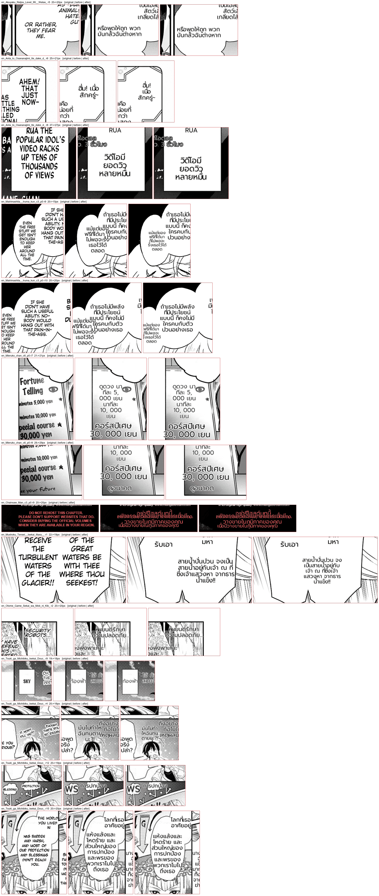

# #795 A dodge lays the text out to the free space — replay A/B on both corpora

- **Date:** 2026-10-21 · **Issue:** #795 · **Before:** `8ec5cce7` · **After:** `bfc9a64d` (`e9f36bb6` + `4f6e194f` + `bfc9a64d`)
- **Corpora:** the 16-page EN corpus (`_mfalse` recordings) and the 11-page second corpus (`_rec` recordings), prod font + render knobs, → THA. Deterministic replay: same translations, only the renderer differs. Four regions of Komi p1 / Lv2 p1 that the first recording never saw were translated live and differ by wording in both arms; they are excluded below.
- **Defect tied to:** Iruma p0 — the balloon detector merged three balloons into one box; the own-balloon clamp then pushed the left balloon's text 14 px into the middle balloon's text.

## What changed

The anti-overlap dodge (`_place_off_neighbours`, `rendering/__init__.py`):

1. The free space is the dodged box clipped to the region's own balloon (when the region sits in it).
2. A block wider than that space is laid out again to fit it (dictionary breaks, then shrink) — Iruma p0.
3. Per axis the block stays inside the free space when it fits, else moves flush with the edge a neighbour pushed in (the balloon clip is not a push — Tsuki p1's sibling stays centred) — Anta p1.
4. If that move runs into another neighbour, the block is centred in the gap between the two — Mieruko p0.
5. Finally it is clamped into its own balloon.

Steps 3 and 4 came from replaying the first version (`e9f36bb6`): it fixed Iruma but dropped the
vertical dodge (Anta p1: 19 px over the caption), and the flush move alone then pushed Mieruko p0's
sign 29 px onto the line below. Each got a red test from the page's own geometry.

## Result

| | second corpus (11 pages) | first corpus (16 pages) |
|---|---|---|
| doctor overlap | 1 → **0** | 2 → 2 (Chainsaw p0 scanlator credits, 9 px lines at a 20 px floor — #796) |
| doctor spill | 0 → 0 | 0 → 0 |
| regions whose layout changed | 7 of 100 | 7 of 146 |
| font shrink | Iruma r9 20→15, Anta p0 r6 25→21 | Mushoku p1 r1 22→19, Tsuki p0 r9 19→18, Tsuki p1 r4/r12 20→18 |

Every changed region is in the sheet. The shrinks are blocks the dodge left narrower: each now sits in
its own space instead of touching the neighbour (Tsuki p1 r4 had run into `ถึงอย่างนั้น`; `ท้องฟ้า` now
fits its card). The rest move 1–15 px.

Noticed while reading the sheet (separate defect, not this change): numbers keep a space after the
thousands comma — `5, 000 เยน`, `30, 000 เยน`, `20, 000 วิว`.
