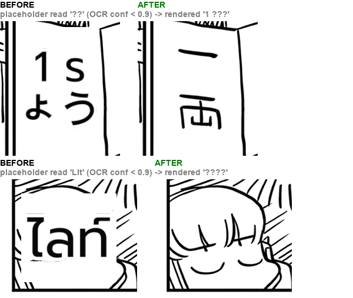

# #797 Low-confidence rescue placeholders dropped — replay A/B

- **Date:** 2026-10-21 · **Issue:** #797 · **Before:** `85041003` · **After:** `f1ca8cbe`
- **Defect tied to:** an empty-balloon / ink-cluster placeholder (a box queued for the VLM rescue, unserved by the current gateway) whose line-OCR read was junk, translated and drawn over the page: Komi p1 `１両` → `1 รょう` (kana in the Thai output) over a Japanese label, `LIt` → `ไลท์` over a character's face.

## Why confidence, not length

A 16-page probe logged every placeholder read with its OCR confidence: every junk read scored
**≤ 0.657** (`TAF` .60, `V` .61, `１両` .66, `LIt` .045, `w` .056) and every real read **≥ 0.959**
(`STICK`, `IS SHE`, `CALLED`, `WAS`, `-AVALA`). The earlier one-character rule missed `LIt`/`TAF`;
a 0.9 cut separates the two groups with room on both sides.

## Result (Komi p0/p1, Otome p1 — the pages with placeholder junk)

| page | before | after |
|---|---|---|
| Komi p1 | `１両 → 1 รょう`, `LIt → ไลท์` rendered | both gone; 9 junk placeholders recorded as `speculative box read as junk` |
| Komi p0 | — | identical |
| Otome p1 | — | identical regions; `！ ！`, `テ` now dropped at the source with a reason (were filtered later) |

No real text was dropped. A placeholder the VLM rescue does serve never reaches this filter.
