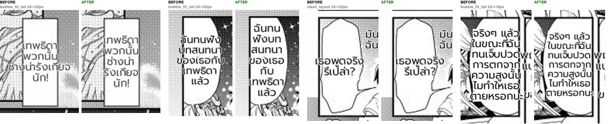

# #816 Tall balloons keep their text inside — replay A/B

- **Date:** 2026-10-21 · **Issues:** #816, #795 (dodge clamp) · **Before:** `f1ca8cbe` · **After:** `a913706b` + the render re-wrap fix
- **Defect tied to:** text in tall balloons spilling 8–25 px past the edge over the art (Tsuki p0/p1), and a clean-layout block dodged out of its own balloon.

## What was wrong, in three layers

1. `bubble_fit_tall` fell back to the flat 20 px unconditionally, even when the block was wider than the balloon interior.
2. The first fix shrank the font instead (one case to 10 px) because the column was never allowed narrower than its longest word. Wrapping straight to the interior width lets the wrapper break that word at its dictionary parts (`น่า|รังเกียจ`) — it fits at the full 20 px as a taller column.
3. The supersampled render then re-wrapped at ≥ the longest whole word and squeezed the wider block into the box, so the text came out visibly smaller than its 20 px. When the layout had to split a word, the render now re-wraps at the layout's own width (byte-identical otherwise).

Plus: an anti-overlap dodge pushed `เธอพูดจริงรึเปล่า?` 12 px out of its balloon; the dodged block is now kept inside its own balloon when it fits.

## Result (16-page corpus, deterministic replay)

| | before | after |
|---|---|---|
| doctor spill | 7 | 4 (Tsuki p0/p1 root spills → 0; the rest are inherited from an earlier stage) |
| font of the Tsuki tall-balloon lines | 20 px, spilling | 20 / 20 / 18 px, inside |
| small-font warnings | 0 | 0 |
