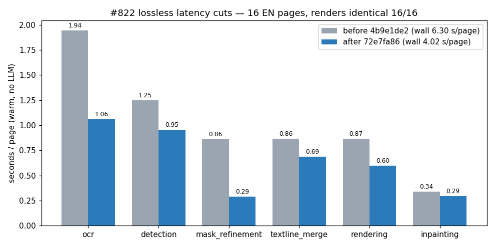

# #822 Lossless latency cuts — identical renders, less time per page

- **Date:** 2026-10-21 · **Issue:** #822 · **Before:** `4b9e1de2` · **After:** `72e7fa86`
- **Setup:** one process per arm, models warm (pass 0 discarded), prod render knobs, translation stage excluded (`translator: original`, VLM rescue off) so only the pipeline is timed; 16 EN corpus pages.

## Output identity

Every page's rendered image is **pixel-identical** before and after (16/16, `np.array_equal`). Each
change is also guarded by a unit test that compares against the original computation bit for bit.

## What changed

| change | why it is lossless |
|---|---|
| balloon YOLO once per page (`ctx.bubble_polygons` shared with the empty-balloon rescue) | same image, same model |
| mask refinement bilateral filter only on the textline rects (+ 8 px radius) | the filter reads only pixels within its radius; equality tested incl. image corners |
| glyph bitmaps copied with `ctypes.string_at` instead of freetype-py's per-byte Python list | same bytes, tested |
| panel `Segment.union_all` uses a set of order-free endpoint keys | equal exactly when `__eq__` is; characterization test vs the old algorithm |
| OCR rotary (XPOS) sin/cos tables cached per (length, offset, dtype, device) | same ops, tested bit-identical |

## Result (warm, mean per page)

| | before | after |
|---|---|---|
| **wall** | **6.30 s** | **4.02 s** (−36%) |
| OCR | 1.94 | 1.06 |
| mask refinement | 0.86 | 0.29 |
| rendering | 0.87 | 0.60 |
| textline merge | 0.86 | 0.69 |
| detection | 1.25 | 0.95 |

Run-to-run noise is about ±0.3 s per stage (an earlier ordering gave 9.47 → 7.10 s wall; a reversed
run of the first three changes gave 6.80 → 6.04 s), so read the stages that were not changed
(detection, inpainting) as noise. The attributable cuts are OCR (XPOS cache) and mask refinement.

## Tried and rejected

48px OCR batches of 64 instead of 16: slower (19.5 → 28.6 s over 16 pages — wider padding) and **not**
lossless (61 of 553 reads changed). Not shipped.
