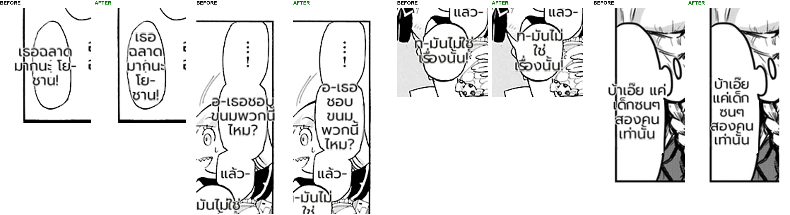

# #832 Narrow tall balloons keep their Thai inside — replay A/B on the second corpus

- **Date:** 2026-10-21 · **Issue:** #832 · **Before:** the live recording (`72e7fa86`-era code) · **After:** `45b93d07`
- **Corpus:** a second EN set fetched for this loop — 11 mid-chapter pages from 6 series not in the first corpus (Iruma-kun, Mieruko-chan, Kaoru Hana wa Rin to Saku, Akuyaku Reijou Level 99, Anta to Osananajimi, Ki ni Natteru Hito). Deterministic replay: same translations, only the renderer differs.
- **Defect tied to:** narrow tall balloons with English stacked in a column spilled the Thai past the balloon edge (`เธอฉลาดมากนะ โย-ชาน!`: 89 px block in a 59 px balloon).

## Result

| | before | after |
|---|---|---|
| doctor spill (11 pages) | 4 | **0** |
| regions changed | — | 4 (exactly the spilling ones) |
| font size of those regions | 20 px | 20 px (dictionary breaks, no shrink needed) |
| overlapping blocks | 1 | 1 (Iruma p0: the detector merged three balloons into one box — separate defect) |

The fix: when a clean-layout block is wider than its balloon's interior, it is laid out again on the
interior with the #816 mechanism (wrap at dictionary parts, then shrink only if still needed).
