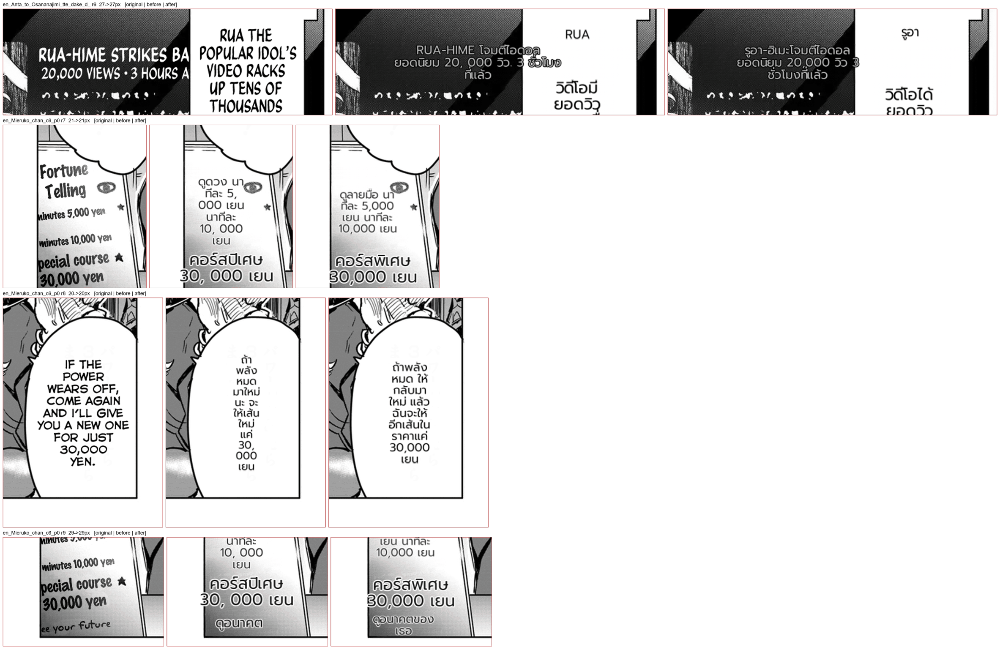

# #842 Numbers keep their separators — live run on the second corpus

- **Date:** 2026-10-21 · **Issue:** #842 · **Before:** the live recording (`_rec`, pre-fix) · **After:** `244d4a0f`, live (`_live842`)
- **Pages:** Mieruko-chan c6 p0, Anta to Osananajimi c3 p1 — every page in both corpora whose translation had a split number.
- **Defect tied to:** `5,000 yen` rendered `5, 000 เยน` (also `10, 000`, `30, 000`, `20, 000 วิว`).

## Why a live run, not a replay

The split happened in `CommonTranslator._clean_translation_output`, *after* the LLM. A doctor replay
substitutes the recorded (already cleaned) text for the whole translation step, so it would replay the
broken numbers. The live run translates again through the qwen gateway, so the wording differs
(`ดูดวง` → `ดูลายมือ`); only the numbers are the point here.

## Result

| region | before | after |
|---|---|---|
| Mieruko p0 r7 | `5, 000 เยน` · `10, 000 เยน` | `5,000 เยน` · `10,000 เยน` |
| Mieruko p0 r8 | `30, 000 เยน` | `30,000 เยน` |
| Mieruko p0 r9 | `30, 000 เยน` | `30,000 เยน` |
| Anta p1 r6 | `20, 000 วิว` | `20,000 วิว` |

Unit test (red first): `test/test_translation_cleanup.py` — `5,000` / `20,000` / `1.5` stay whole;
`Hello,world.Bye` → `Hello, world. Bye` and `5,ไม่ใช่` are still spaced. Full MIT suite 911 passed.

Noticed in the sheet (separate defect): Mieruko r7 breaks `นาที` across lines as `นา|ทีละ`.
