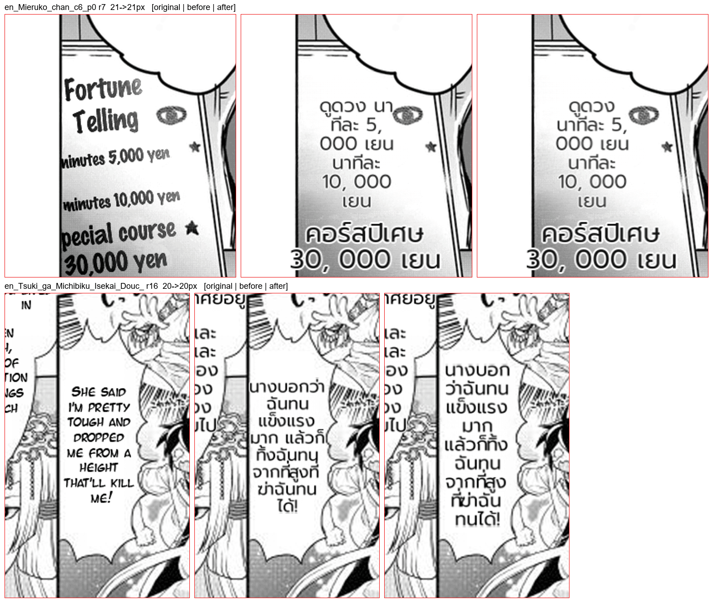

# #844 Thai wrap breaks segmenter ties by word frequency — replay A/B on both corpora

- **Date:** 2026-10-21 · **Issue:** #844 · **Before:** `bfc9a64d` · **After:** `18307842`
- **Corpora:** the 16-page EN corpus and the 11-page second corpus, deterministic replay (same translations, only the renderer differs).
- **Defect tied to:** Mieruko p0 — `นาทีละ` ("per minute") wrapped as `นา / ทีละ`.

## Why frequency, not another engine

newmm minimises the word count; `นาทีละ` splits into two dictionary words two ways (`นา|ทีละ`,
`นาที|ละ`) and newmm takes the shorter first word. Over 621 rendered translations the `longest`
engine disagreed with newmm on 203 and was wrong far more often (`แน่น|อน`, `อะ|ไร`, `ฉันท|นท|า|นม|าก`),
so the engine stays. newmm's own wrong breaks were all such ties; TNC frequencies (bundled with
pythainlp) pick the right reading in each, and the two cases where they would not (`ผู้|ทรงพลัง`,
compounds TNC lacks) are excluded by rule. Offline over 651 corpus translations the rule changes 8
distinct pairs, all correct: `โจมตี|เมือง`, `ก่อตั้ง|ขึ้น`, `แล้ว|จะ`, `นาที|ละ`, `ตัดสินใจ|มา`, `บอก|ว่า`,
`ขับไล่|ผี`, `แสงสว่าง|จ้า`.

## Result

| | second corpus (11 pages) | first corpus (16 pages) |
|---|---|---|
| regions whose layout changed | 1 of 100 (Mieruko p0 r7) | 1 of 146 (Tsuki p1 r16) |
| doctor spill / overlap | 0 / 0 → 0 / 0 | 0 / 2 → 0 / 2 |

Mieruko r7: `นาทีละ` now stays on one line. Tsuki r16: `นางบอกว่า / ฉันทน` → `นางบอก / ว่าฉันทน`
(the break now falls between `บอก` and `ว่า`, a natural break point). (`5, 000` in the replayed text is the
recording's; #842 fixes it in the translation cleanup, which a replay does not re-run.)

Cost: the TNC table loads once per process (~0.2 s); segmentation stays cached per text.
