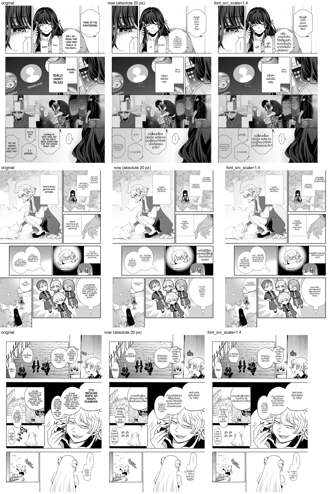

# #851 One dialogue font size per page (opt-in `font_src_scale`) — A/B on both corpora

- **Date:** 2026-10-21 · **Issue:** #851 · **Code:** `5216c39a` + `d5fda3a3` (knob, default 0 = byte-identical)
- **Arms:** `_sl` (default) vs `_s14b` (`render.font_src_scale=1.4`), same code (`06112b58`), deterministic replay of both EN corpora + the JP page.
- **Defect tied to:** dialogue size inconsistent within a page (Kaoru p0: 35 px next to 20 px; Akuyaku p0: 37 px next to 20 px) and most dialogue smaller than the source lettering (Thai at 20 px has ~11 px consonants against ~18 px source caps).

## Measurements behind the design

- Source caps ink height ≈ `font_src_px` (18 px ↔ 18 px, measured on Kaoru/Akuyaku/Iruma crops).
- Prompt: Thai consonant 0.55 em, Latin caps 0.70 em.
- `font_size_max=20` is absolute: 1.8× the source on Iruma (a 777 px page), 0.83× on Kaoru — the inconsistency is page-resolution blindness, and `bubble_fit_sole` ignores the cap entirely.
- Scale candidates rendered on three pages (1.25 / 1.5 / 1.8): caps-lettered Kaoru looked right at 1.25, mixed-case Akuyaku and Iruma at 1.5 (`font_src_px` runs ~20 % high on caps); 1.4 was taken for the A/B.
- First A/B (all text): spill 0 → 4, overlap 2 → 12, all from balloon-less text (contents lists, signs) and one block too tall for its balloon → second version: page size only for text in a balloon, and a too-tall block is re-laid.

## Result (second version, `font_src_scale=1.4`)

| | now | 1.4 |
|---|---|---|
| balloon text: Thai consonant ÷ source caps (median, p10–p90) | 0.55 (0.46–0.87) | **0.77** (0.57–1.00) |
| balloon font max/min within a page (median) | 1.55 | **1.33** |
| pages whose balloon fonts differ by > 1.5× | 11 of 21 | **4 of 21** |
| doctor spill / overlap | 0 / 2 | 1 / 6 |

## Decision

A tradeoff: text matches the source and the page much better, at the cost of 4 new overlaps and
1 spill (Akuyaku p1, Iruma p1, Kage p1, Anta p1, Mushoku p1). It stays **opt-in** (default 0) — per
the goal rule a tradeoff is not a default — and the scale is the user's call from the sheet above.

## Update — making it tradeoff-free (2026-10-21, later)

Code review and four more A/B rounds (`d8cb89ef` → `077f8084`), each fixing what the previous round showed:

| round | change | spill / overlap (knob off: 0 / 2) | balloon font spread (median, off: 1.55) |
|---|---|---|---|
| `d8cb89ef` | page size caps growth, respects the minimum, skips SFX | 1 / 6 | 1.13 |
| `7cd7e0d1` | sole balloon occupant only; a block that does not fit its box falls back to the absolute font | 0 / 2 | 1.48 |
| `8d67df60` | instead of falling straight back: the largest size ≤ the page size that fits (balloon interior, or own footprint when shared) | 1 / 2 | 1.45 |
| `077f8084` | the fit check has no slack (a 303 px block had passed a 292 px box) | 0 / 2 on the page that spilled (Kage p1) | — |

Balloon text is now 0.76 of the source size on average (off: 0.55) and spill/overlap match the knob
being off. What remains is a judgement, not a defect count: pages whose source lettering itself varies
(Akuyaku p1: shouted `NYA`/`AH`/`EH` at 31–39 px beside 17–19 px dialogue) keep that variation, and the
right scale (Kaoru favoured ~1.25, Akuyaku/Iruma ~1.5) is a look the user picks. Still opt-in (default 0).
