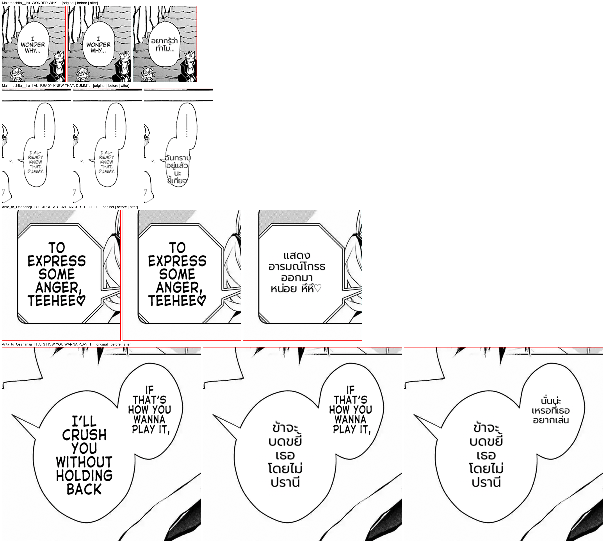

# #857 English balloons no longer dropped over one OCR-noise glyph — replay on both corpora

- **Date:** 2026-10-21 · **Issue:** #857 · **Before:** `7a971cfc` (`_f0`) · **After:** `06112b58` + `8ec816dd` (`_sl`, `_sl2`)
- **Corpora:** both EN corpora (27 pages) + the JP One-Punch page, deterministic replay; texts the recording never saw (the recovered ones) are translated live through the qwen gateway.
- **Defect tied to:** Iruma p0 left `I WONDER WHY…` and `I ALREADY KNEW THAT, DUMMY.` in English, with nothing in the doctor's `dropped` list.

## Root cause, traced

| step | evidence |
|---|---|
| detection | probe: `WONDER` 0.82, `WHY..` 0.92, all five lines of the second balloon detected |
| OCR | lone `I` read as `피`; a stray `○` caught → `피 WONDER WHY..`, `I AL- READY KNEW THAT, DUMMY. ○` |
| `/patches` source filter | log: `dropped 2 regions: KO: "피 WONDER WHY.."; MT: "I AL- READY KNEW THAT, DUMMY. ○"` |
| why | `_detect_region_source_lang` returned `region.source_lang` first — on a `TextBlock` a lazy `langid` guess, never empty — so its mostly-ASCII Latin guard was dead code |

Two hypotheses were falsified on the way (a detector miss; the filter's pure-ASCII shortcut).

## Fix

1. `06112b58` — the mostly-ASCII Latin guard runs before `region.source_lang`; CJK text cannot be mostly ASCII, so a Japanese region is still dropped for an English request.
2. `8ec816dd` — kept, `피 WONDER WHY..` translated as `เพราะ WONDER` (the noise threw the LLM off) and `╩ THATS HOW…` carried the `╩` into the Thai. `strip_noise_glyphs` drops whitespace tokens made only of non-Latin glyphs from mostly-ASCII source text before translating (Latin-script source only). Across every corpus recording exactly these 3 texts match.

## Result

| | before | after |
|---|---|---|
| regions rendered (27 EN pages + JP) | 253 | **257** |
| recovered | — | Iruma p0 ×2, Anta p0 `TO EXPRESS SOME ANGER TEEHEE♡` (dropped over the `♡`), Anta p1 `THATS HOW YOU WANNA PLAY IT,` |
| their Thai | (English left on the page) | `อยากรู้ว่าทำไม..`, `ฉันทราบอยู่แล้วนะ …`, `แสดงอารมณ์โกรธออกมาหน่อย หึหึ♡`, `นั่นน่ะเหรอที่เธออยากเล่น` |
| doctor spill / overlap on those pages | 0 / 0 | 0 / 0 |

Noticed: Iruma's `I ALREADY KNEW` balloon has two lobes; the block fits the balloon's bounding box but
touches the narrow lower lobe's outline (multi-lobe class — separate). Not done here: the filter's drops
still do not reach the payload's `dropped` list (the doctor stayed blind to this bug) — follow-up.
