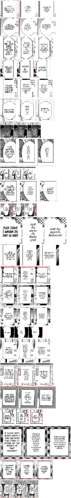

# #864 Tall balloons keep the letterer's column — replay A/B on both corpora

- **Date:** 2026-10-21 · **Issue:** #864 · **Before:** `_sl` (`06112b58`) · **After:** `_q4` (`7d804281` = `a10a303c` + `2d2c4a3d` + `7d804281`)
- **Corpora:** both EN corpora (27 pages) + the JP One-Punch page, deterministic replay (regions translated live in either arm — Lv2 p1, Komi p1 — are excluded from the counts).
- **Defect tied to:** Kaoru p0 — `THINK OF THE SIGHTSEEING!` (two 152 px lines in a tall octagon) rendered as a 60 px column, one word per line.

## Root cause and fix

`bubble_fit_tall` lays text out on the balloon interior through `_clean_layout_dst`, whose
`squeeze_width` narrows the column until the block fills the box's **whole height**. Right when the
source lettering fills a tall box (Otome `THIS SCUMBAG`, the case the branch was built for), wrong when
the letterer set a short wide block in a tall balloon. The interior proxy now carries the source
footprint (`letter_w`, `letter_h`): the squeeze aims at the source height, and the wrap starts at
0.9 × the source width; the existing fit still widens or shrinks when the text does not fit.

Three iterations, each caught by this replay:

| version | what the replay showed |
|---|---|
| `a10a303c` squeeze toward source height | Kaoru fixed; Kage narration text wrapped to the full interior and sat on the box border (614..771 in 616..769) |
| `2d2c4a3d` + start at the source width | Kage fixed; Mieruko p1 `เด็กพวกนี้` touched an elliptical balloon's outline (source measured at its widest line) |
| `7d804281` start at 0.9 × source width | Mieruko/Otome back to their earlier shape; Kaoru 3 lines (was 6), Kage inside the box |

## Result

| | before | after |
|---|---|---|
| regions whose layout changed | — | 24 of 257, all `bubble_fit_tall` |
| doctor spill / overlap | 0 / 2 | 0 / 2 |
| tall blocks within 2 px of the container side | 12 | 12 (Iruma p1 r1 cleared; Lv2 p1 r10 is a live-translated text that touches in both arms) |
| tall block height (median, in font sizes) | 6.0 | 4.8 — fewer, fuller lines |

Kaoru r3: `คิดดูสิ / ว่าวิว / มันจะ / สวย / แค่ / ไหน!` → `คิดดูสิว่าวิว / มันจะสวยแค่ / ไหน!`. Anta p0:
`ยู- / ทิวบ์!` → `สวัสดี / ยู-ทิวบ์!`. Chainsaw p1, Kumo, Komi, Kage: 6–9 short lines → 3–5 full ones.
No tradeoff found → default.
