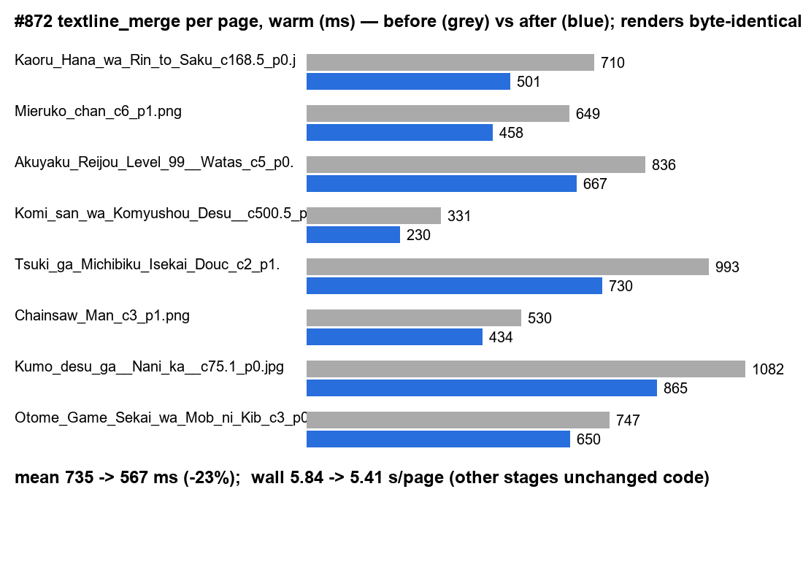

# #872 textline_merge hot spots — lossless, renders identical

- **Date:** 2026-10-21 · **Issue:** #872 · **Before:** `7d804281` · **After:** `3d0e7f80` (`45c9c2c0`, `347ccd4b`, `7024f116`, `3d0e7f80`)
- **Method:** warm in-process probe (models loaded, pass 0 discarded), prod knobs, LLM excluded (`original` translator), 8 corpus pages; renders compared byte for byte.

## Where the time went (warm cProfile, 4 pages)

`_run_textline_merge` 4.2 s total: `sort_regions` → panel detection (Kumiko) 2.9 s, textline merge
itself 0.84 s, balloon association 0.40 s. Inside panel detection: a temp-PNG round trip (imwrite
0.17 s + imread 0.14 s), `Segment.union_all` 1.04 s (51k `union` calls, each re-computing sqrt/atan and
building 2-element numpy arrays), LSD 0.59 s (native), `split` 0.67 s.

## Changes (each lossless, each with a characterization test)

| commit | change | check |
|---|---|---|
| `45c9c2c0` | Kumiko takes the page array; no temp PNG | panels == disk round trip, both reading orders; input unmodified |
| `347ccd4b` | segments cache length and angle (endpoints immutable) | cached == formula on every call |
| `7024f116` | `projected_point` in plain floats, same arithmetic | == the numpy version, 2000 segments × 3 input shapes |
| `3d0e7f80` | balloon association checks the polygon bbox before the ray cast | == ray-casting everything, 60 random pages |

## Result (8 pages, warm)

| | before | after |
|---|---|---|
| renders | — | **byte-identical 8/8** |
| `textline_merge` | 735 ms | **567 ms (−23 %)** |
| wall | 5.84 s | 5.41 s (other stages' code unchanged — their delta is run noise) |

Per-step probes agreed: −66, −93, −102 ms on `textline_merge`, each step identical 8/8. Left for later:
LSD (native, 0.15 s/page) and `Panel.split` (0.17 s/page) — the next candidates.
