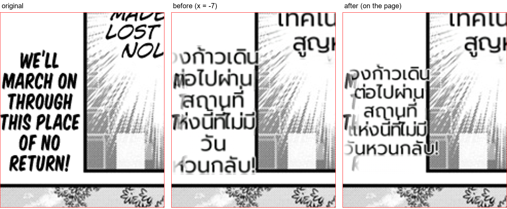

# #873 Text near the page edge stays on the page — replay on both corpora

- **Date:** 2026-10-21 · **Issue:** #873 · **Before:** `_q4` · **After:** `7f3ee20e` (`_q5`), deterministic replay of both EN corpora.
- **Defect tied to:** Otome p0 — gutter narration `WE'LL MARCH ON THROUGH THIS PLACE OF NO RETURN!` (source x 0..79) rendered from x = −7; its first letters were cut by the page edge.

## Fix

`clean_layout` centred the Thai block on the source region; wider than the source, it crossed the page
edge. The block's centre is now clamped so it stays on the page — the image on a full-page render, the
page edges in crop coordinates (`region.page_bounds`, set by the patch renderer) on a patch.

## Result

| | before | after |
|---|---|---|
| Otome p0 r0 block | x −7.5 .. 86.5 | **x 0 .. 94** |
| other regions changed (250) | — | 0 |
| doctor spill / overlap | 0 / 2 | 0 / 2 |
