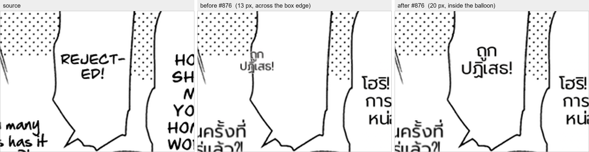

# #876 A neighbour balloon's bbox no longer cuts this balloon's interior — deterministic replay

- **Date:** 2026-10-21 · **Issue:** #876 · **Before:** `d5802c80~1` (`_b0`: only `rendering/__init__.py` reverted) · **After:** `d5802c80` (`_b1`), `doctor_page.py --replay` on the recorded dumps.
- **Corpora:** corpus 3 (12 pages) for the code-isolated A/B, then the full corpus 2 + corpus replay (27 pages).
- **Defect tied to:** Horimiya p0 — `REJECT-ED!` rendered at **13 px across its balloon's left edge** instead of 20 px inside it.

## Root cause, traced

| step | evidence |
|---|---|
| render | `doctor.json` r2 `font_px` 13, `dst_box` x 298.9 .. 337.9, `render` **FAIL** |
| fit box | the region's own polygon interior is 87 x 167 px; after neighbour clamping only **14 px** wide remained |
| why | the next balloon's **bbox** overlaps this balloon although the polygons never touch, so `_neighbor_territories` pushed the fit box off its own interior |

## Fix

`_neighbor_territories` takes `text_only`: when the fit box is the region's own polygon interior a neighbour counts by its **text box** — that interior cannot enter another balloon, it can only collide with another region's text. Without a polygon behaviour is unchanged.

## Result

| | before | after |
|---|---|---|
| Horimiya p0 r2 font | 13 px | **20 px** (source 16 px) |
| r2 box x | 298.9 .. 337.9 | 325.5 .. 384.5 |
| doctor `render` failure on r2 | FAIL | **none** |
| corpus 3 pages byte-identical | — | **11 / 12** |
| corpus 2 + corpus replay (27 pages) | — | 3 + 3 pages changed, all layout (dodge / font), no spill or overlap added |

**Replay caveat, measured:** r6 on the same page differs in *text* (`แปลกประหลาด…` -> `แปลกจัง...`). `STRANGELY…` is absent from the recording (24 recorded regions), so the replay translates it live through the qwen gateway — that difference is LLM sampling, not this change; the layout difference is the dodge.

**Not this change, kept for the next round:** Horimiya p0 keeps `merge` failures on r18/r19 (FAIL) and r22/r23 (WARN) in **both** arms, and the two Tsuki pages (`c2 p0` `detect`, `c2 p1` `merge`) fail identically in `_q`, `_q5` and `_q6` — pre-existing replay failures.
