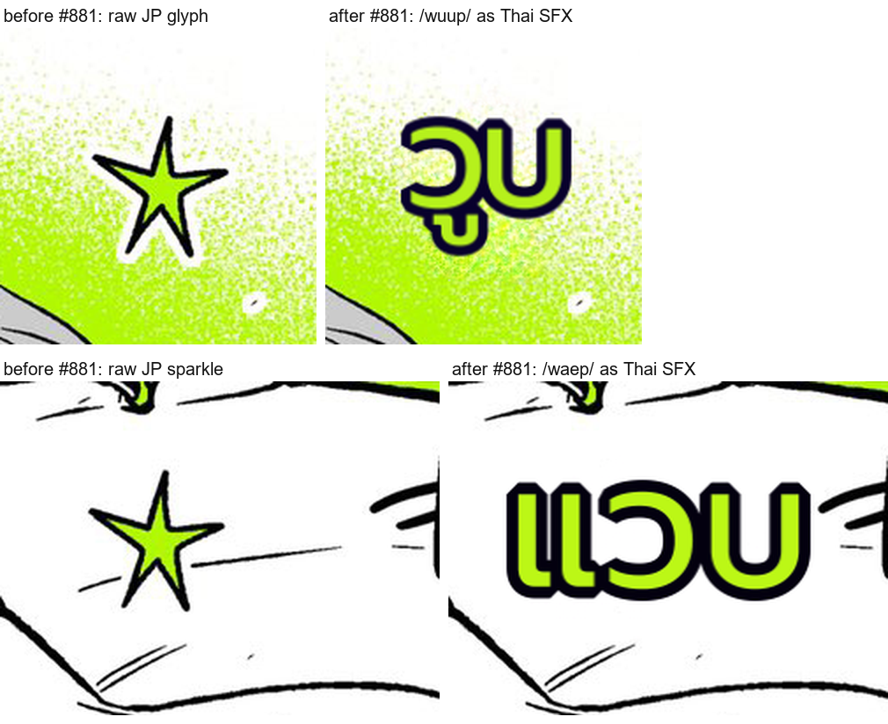

# #881 The vision SFX rescue serves — 20 stylized SFX rendered as Thai over the 39-page corpus replay

- **Date:** 2026-10-22 · **Issue:** #881 · **Before:** `_q6` / `_b1` (24-token budget: every rescue call truncated) · **After:** `SFX_MAX_TOKENS = 512`, `doctor_page.py --replay` on both EN corpora + corpus 3 (39 pages).
- **Defect tied to:** the configured gateway model is a thinking model. At `max_tokens=24` it returned `finish_reason=length` with `content=''` after spending the whole budget on reasoning (measured on the Boku SFX crop: 24 and 128 truncate; 192 completes after 154 reasoning tokens; 256/384/512 identical). `vlm_localize_sfx` read that empty reply as "no SFX here", so no stylized SFX was ever localized — and after three the `#693` breaker paused the rescue for 300 s.

## Result — the rescue actually serves

| | before | after |
|---|---|---|
| `sfx_display` regions (localized SFX) | 0 | **20** across **13 / 39 pages** (20–22 between runs: the rescue is a live model call) |
| render spill / small_font | 0 / 0 | 0 / 0 |
| render overlap | 2 (Chainsaw p0) | 3 (Chainsaw p0, Mieruko p0 — the pre-existing stacked-credit class, #883) |
| dialogue regions changed | — | **0** |

Texts now drawn: วูบ · ฟู่ · ฟึ่บ · วืด · ฟาด · แวบ · ซ่า · เป๊าะ · กึกกัก.

The four regions that disappeared were single Japanese glyphs the line-OCR read as text and the translator
transliterated literally (`刀`→`ดาบ`, `才`→`ซาย`, `ザワ`→`ซาวา`, `平ク`→`เฮย์ระคุ`); each is now the rescued Thai
SFX instead.

## Doctor side effect, fixed

A rescued display SFX is drawn at its source glyph size (173 px against a 20 px dialogue median), which
tripped the detect probe's implausible-region check on **7 of 39 pages** the moment the rescue started serving.
The payload now carries `sfx_rescued` (additive key, emitted only when the rescue flagged the region) and the
probe skips both that flag and the `sfx_display` branch (`8a326900`, plus the flag half in the next commit).

**Replay caveat:** in `--replay` the translation comes from the recording, so a recorded SFX carries no live
`sfx_rescued` flag and the probe can still flag it (Tsuki p0 `月`/`ตุ้บ`, Mushoku `을`). Those are honest
leftovers of replay-mode, not of a production run, where the rescue sets the flag.

## Caveat

Disabling thinking is not an alternative: the same crop then reads as a junk transliteration (`ซึ่่ง`).
