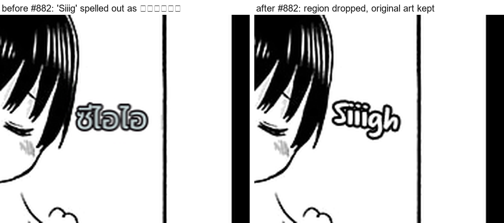

# #882 Letter-name spellings are dropped — the junk `ซีไอไอ` is gone, the original art stays

- **Date:** 2026-10-22 · **Issue:** #882 · **Page:** Boku no Kokoro no Yabai Yatsu c9 p0.
- **Defect tied to:** the bubble-letter SFX `Siiigh` was OCR-read as `Siiig` and the translator, with nothing
  to translate, spelled the letters out into `ซีไอไอ` — rendered as junk over the artwork (font 22 px).

## Guard

`translation_quality.is_letter_name_spelling(source, translation)` — a drop needs all four signals, each
measured against the 39-page corpus:

1. the translation is Thai-only and splits COMPLETELY into Thai letter-name syllables, at least 3 of them
   (DP segmentation; the names are not prefix-free — `เอ` vs `เอฟ`/`เอส`);
2. the source is one 4-10 letter ASCII token;
3. the source is not all-caps (all-caps tokens are abbreviations that legitimately get spelled: `OMG`, `RTSD`);
4. the source repeats a letter — the shape of a stylized-art read (`Siiig`, `Aaaah`).

Wired into the post-translation drop filter (`region_filter.py`, reason *Letter-name spelling of stylized
art*). A dropped region is not inpainted, so the original art stays instead of junk text.

## Evidence

| | |
|---|---|
| corpus scan (39 pages, all regions) | **exactly 1** region would be dropped (`Siiig` -> `ซีไอไอ`); 0 other regions even fully segment into letter names |
| replay of Boku p0 | regions 12 -> 11, new drop reason `Letter-name spelling of stylized art`, junk gone from the payload |
| torch-free gate | 830 passed, 3 skipped |
| negatives pinned in tests | `SOR`->`ขอ...`, `OMG`->`โอเอ็มจี`, `OK`->`โอเค`, `LOOM`->`ลูม`, normal dialogue |

## Not done (recorded in #882)

The ideal output for that region is a localized Thai SFX (`เฮ้อ`) from the vision rescue, not the original
English art. That needs the rescue to fire on letter-read art (the provenance gate correctly refuses ASCII
today) — a separate discriminator, filed as the follow-up in the issue.
