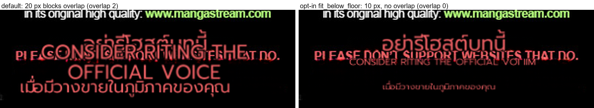

# #883 Opt-in: a block that cannot fit its gap shrinks below the readable floor

- **Date:** 2026-10-22 · **Issue:** #883 · **Page:** Chainsaw Man c3 p0 (the `NOTICE:` credit block).
- **Problem:** three 9 px credit lines sit 6-15 px apart. The readable floor lifts each block to 20 px
  (~48 px tall), taller than the gap, so the anti-overlap pass — which by design centres a too-tall block
  in its gap — leaves them overlapping (doctor `render` overlap 2).

## Change

`render.fit_below_floor` (default **off** → byte-identical). When a clean-layout block still does not fit
the space its neighbours leave, it is re-laid at sizes below `font_size_minimum` (down to half, min 6 px)
and takes the largest size that fits. Small text beats overlapping text — but it is a readability call, so
it is opt-in per the goal's tradeoff rule.

| replay A/B (rescue off, same dump) | default | `fit_below_floor` |
|---|---|---|
| doctor `render.overlap` | **2** | **0** |
| r2 (region 8) | 20 px, box y 729-777 | **10 px**, box y 747-759 |
| r3 (region 9) | 20 px, box y 766-790 | **10 px**, box y 772-784 |

## Caveat (why the default stays off)

The figure shows the other half of #883: the original English credits stay partly visible behind the Thai
because these thin lines get tight inpaint masks — unrelated to the overlap, still open in the issue.

## Verification

- 2 new tests (flag on shrinks to fit; flag off keeps the #795 floor behaviour), torch-free gate **839 passed**.
- Enabling the flag is `MIT`-side only for now: `--set render.fit_below_floor=true` in the doctor, or the
  render config field once the Backend passes it.
