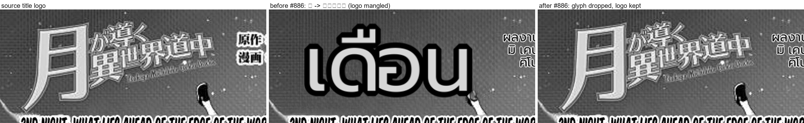

# #886 A single logo glyph at art scale is dropped — the artwork stays intact

- **Date:** 2026-10-22 · **Issue:** #886 · **Page:** Tsuki ga Michibiku Isekai Douchuu c2 p0.
- **Defect tied to:** detection picked up only the `月` of the title logo `月が導く異世界道中`; the page showed a
  big Thai `เดือน` in its place while the rest of the logo stayed Japanese — the logo was mangled.

## Guard

`translation_quality.is_oversized_art_glyph(text, font_size, rescued)` — one or two CJK/Hangul glyphs and
source lettering >= 100 px are art, not dialogue. The post-translation filter drops them (`Oversized art
glyph (logo/title)`), so they are never inpainted and the original art stays. A region the vision rescue
already localized is excluded — that is the SFX path and it produced a target-language onomatopoeia.

| replay | result |
|---|---|
| Tsuki p0 | `月` dropped, regions 16 -> 15, logo intact |
| Mushoku Tensei c110 p0 | `을` was RESCUED instead (`เคี้ยว`, sfx_display) — the guard correctly deferred to the rescue |
| corpus scan (39 pages) | exactly 2 art-scale single-glyph regions, both above |

## Not done

Whether the 2-glyph bound is right needs the full 39-page replay sweep (next round, together with the other
filter changes). Below the art threshold the glyph is ordinary readable text and is translated normally.
