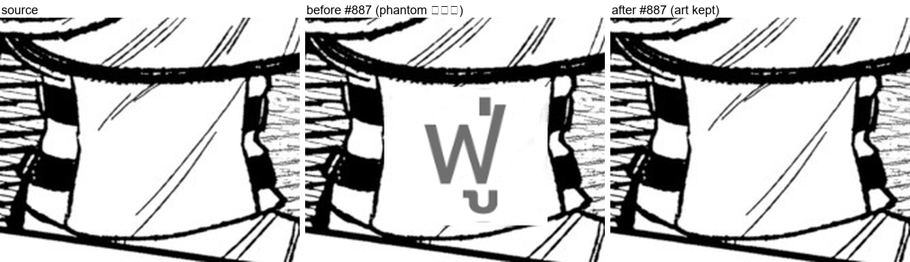
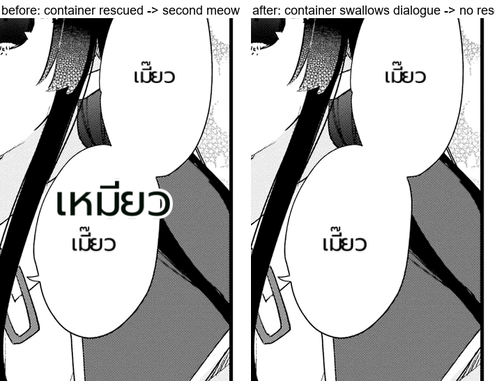

# #887 A crop without lettering never reaches the vision rescue — phantoms mostly gone

- **Date:** 2026-10-22 · **Issue:** #887 · **Page shown:** Taida na Akujoku Kizoku ni Ten c10 p0.
- **Defect:** det_sfx boxes on plain art (armour, panel borders, clothing) were sent to the vision rescue;
  the model invented an onomatopoeia and the page rendered it as a large phantom SFX over blank artwork.

## How many were phantoms? All but a few

Every `sfx_display` region on the corpus (20) was cropped and inspected by eye: **15 had no lettering at all**
(blank panels, borders, armour, clothing, a star sparkle, a kanji art glyph). Only 5 were real katakana SFX.

## Guard

`ocr_vlm.crop_has_lettering(crop)` — lettering has high contrast and a solid dark core: grayscale **std >= 75**
and **>= 12 % very-dark pixels**. Measured on the 20 crops: the 5 real katakana scored std 78-92 / dark
0.15-0.32; the 15 art crops scored std 27-74 / dark <= 0.12. The check runs **before the vision call**, so it
also saves ~2.3 s per refused crop.

## Result

| | before | after |
|---|---|---|
| rescued SFX regions over the 13 affected pages (replay) | 20 | **8** |
| of which real lettering | 5 | **4 katakana + 1 hiragana art** (`あせ`) |
| phantom regions | **15** | **4** (thick non-lettering strokes: an arc, an oval, a `刀` art glyph, `あせ`) |
| Taida p0 (the reported page) | phantom `ฟู่` over armour | **no phantom, art intact** (figure) |

Residual phantoms are **single thick non-lettering strokes** — they pass any ink threshold. The next
discriminator would count separate letter strokes (cv2 connected components), but that adds a dependency to
the torch-free module; the ink guard already removes 11 of 15.

## Round 2 — the single thick strokes are gone too (stroke count)

The 4 residuals were **one connected dark stroke** each (an arc, a thick oval, a `刀` art glyph, and `あせ`
hiragana art). Lettering is several separate strokes, so the guard now also requires **>= 2 dark components
covering at least 1% of the crop** (`cv2.connectedComponentsWithStats`, imported lazily; if cv2 is missing the
guard falls back to the contrast verdict rather than dropping rescues).

Measured component counts on the crops the contrast guard admitted: lettering 3-7, single thick strokes 1.

| | contrast rule | + stroke rule |
|---|---|---|
| rescued regions over the 13 affected pages | 8 | **5** |
| pages with any SFX | 6 | **4** |
| of which real lettering | 4 + 1 art | **5 (all real: ザッ x2, ドン, `Dash!`, `あせ`)** |
| phantom regions | 4 | **0** |

## Round 3 — a container that swallows dialogue is never rescued

Akuyaku p1 showed a second meow: the merge produced one big container region whose own OCR read was junk
while it fully covered the balloon's `NYA` line, so the rescue lettered `เหมียว` over the bubble next to the
proper `เมี๊ยว`.

`ocr_vlm.swallows_dialogue(box, dialogue_boxes)` — a region that contains >= 70 % of another region's dialogue
box is not an SFX. Wired into the rescue gate next to `should_rescue_sfx`. Replay of the page: **9 regions,
no Thai source text** (the duplicate is gone) and both real bubbles keep their `เมี๊ยว`.

## Also updated

The Doctor's LLM contract probes: a uniform canvas now reports *"no request: the crop has no lettering, the
guard refused it (#887)"* as **OK** instead of FAIL — sending a blank canvas is no longer possible, so the
contract is met upstream (test renamed `test_a_blank_canvas_is_never_sent_887`).

| verification | result |
|---|---|
| guard classification of the 20 recorded crops | kept exactly the 5 real katakana |
| Osoraku p0 replay (3 phantom regions) | 13 regions / 3 SFX -> **10 regions / 0 SFX** |
| 13 affected pages, replay | 20 -> 8 rescued, 13 -> 6 pages with any SFX |
| tests | 3 guard tests (blank/lettered/no-request), contract test updated, gate **842 passed** |
