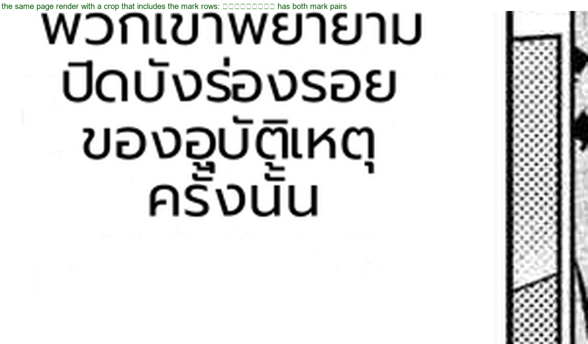

# #895 closed as invalid — the stacked marks were there (an investigation artefact)

- **Date:** 2026-10-22 · **Issue:** #895 · **Verdict:** not a defect; the fix was reverted (`2f8a5e92`).

## What happened

The claim was that Kumo p0's caption line `ครั้งนั้น` rendered as `ครงนัน` (stacked marks missing). The crops
behind that claim started just below the mark rows, so the marks fell outside the window and the line *looked*
mark-less.

Three checks settle it:

| check | result |
|---|---|
| pixel comparison across runs (`_THAr2`, `_THA_final`, the attempted fix) | **identical images, 0 changed pixels** |
| crop that includes the rows above the line | `ครั้งนั้น` with **both mark pairs** (figure) |
| `text_render.put_text_horizontal` in isolation | marks present |

## What was tried before closing

A per-line leading reserve (`_stacked_mark_overhead`) was implemented and shipped; it changed renders on 8 of
11 replayed pages by a few pixels of line spacing, and it *did not change Kumo p0 at all* — because that
region's line spacing already clears the marks. With the defect unproven and the change unneeded, the commit was
reverted; the revert is the record.

## Lesson recorded

1. A crop must include the rows the marks live in *before* calling a mark missing (crop bounds are part of the
   evidence).
2. The cheapest discriminator for a rendering regression is a **pixel comparison of the same page across runs** —
   identical bytes mean identical rendering, so the difference is in the observation, not the pipeline.
3. A render change motivated by an unproven defect does not ship, however plausible the mechanism.
