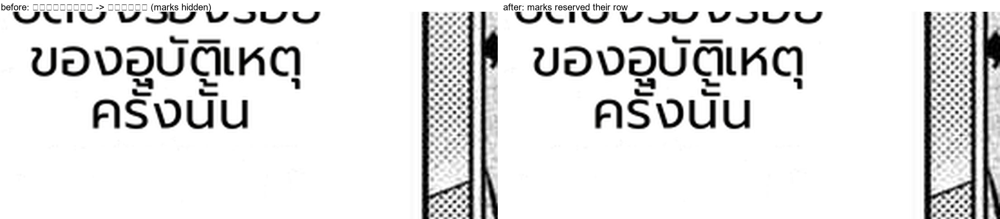

# #895 Stacked Thai marks get the leading they need (Kumo p0: ครั้งนั้น no longer ครงนัน)

- **Date:** 2026-10-22 · **Issue:** #895 · **File:** `manga_translator/rendering/text_render.py`.
- **Defect:** the horizontal renderer's line pitch is `font_size` (+ tiny spacing). A Thai tone mark stacked on
  an upper vowel is lifted (the #793 rule) to `bitmap_top + lift`, which reaches above its own row and is drawn
  over the previous line's row. Where that row has ink at the same x, the mark is dark-on-dark and disappears —
  Kumo p0's `ครั้งนั้น` rendered as `ครงนัน`.

## Fix

`_stacked_mark_overhead(line, font_size)` — the height by which a line's lifted marks exceed one row, plus an
8 % descent allowance so the mark clears the glyph bodies of the line above. `put_text_horizontal` adds that
leading only for lines that need it (canvas height, first-line offset, and per-line advance). Lines without
stacked marks (all Latin text) add nothing → byte-identical; a font whose marks already sit high adds nothing
either, because `_stacked_mark_lift` returns 0 for it.

| check | result |
|---|---|
| `_stacked_mark_overhead('กลาง', 29)` | 0 |
| `_stacked_mark_overhead('ครั้ง', 29)` | 4 (needs the extra row) |
| Kumo p0 re-rendered | line 7 reads `ครั้งนั้น`, marks visible (figure) |
| tests | 2 new (`test_thai_wrap.py`), gate **851 passed** |

## Corpus verification

Pending: 39-page deterministic replay with the fix (`_marksfix`) to confirm no spill/overlap regressions from
the added leading.
