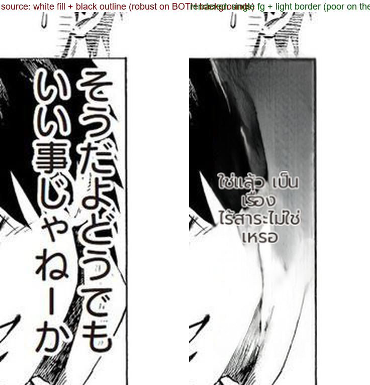

# JP→TH visual review: the first real production-path defect (#899)

- **Date:** 2026-10-22 · **Material:** the two real Japanese pages in `Backend/uploads/chapters/752fc515-…/`
- **Method:** ran the pipeline (JP→TH), then zoomed every region with generous crop margins (the #895 lesson:
  include the rows the marks live in).

## What held up

- All 7 regions on p0 and 7 on p1 contain their Thai; nothing overflows the balloons; the narrow columns
  mirror the source's vertical layout (#183 by design). The negation guard keeps the meaning (see #898).

## What did not (#899)

Region #5 (p0) straddles the character's black hair and white paper. The source lettering is **white fill with
a black outline** — readable on both. The renderer sampled the lettering's **average** colour (white fill +
black outline -> mid grey), so the Thai comes out washed out on the black half and nearly invisible on the
white half. The source region's brightness histogram is bimodal (20 % near 0, 74 % near 224, std 103) and
`merge_bboxes_text_region` averages the per-textline colours.

## Status

Filed as **#899** with a proposal (snap the fill to the dominant cluster when the lettering sample is bimodal;
fallback: worst-case contrast over the erased patch) and the acceptance bar: a colour-choice unit test, the real
JP page fixed, and the 39-page EN replay showing no regression before it becomes a default. Not implemented in
this round — #266's luminance-band attempt was rolled back, so a colour change ships with corpus evidence, not
with a hunch.
