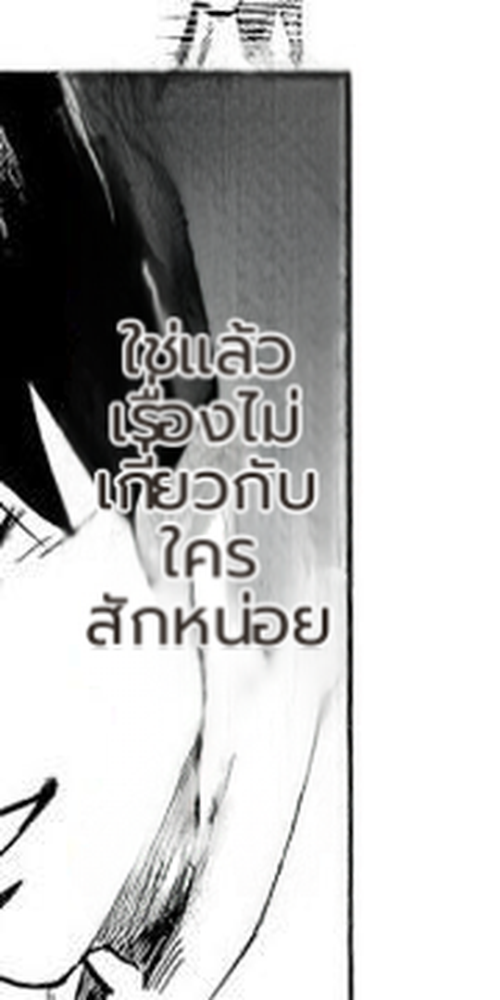

# #899 investigated: the grey-fill symptom does not reproduce at HEAD; the real risk needs a background-aware fix

- **Date:** 2026-10-23 · page: the uploaded JP page from the issue (`Backend/uploads/chapters/752fc515-…`), source JPN.

## Measurement at HEAD

Sampled the original pixels inside every region's line quads and printed the two-tone statistics (`MIT_LOG_BIMODAL`
instrumentation, reverted after the experiment):

| region | dark cluster (luma) | bright cluster (luma) | fraction | OCR-sampled fg / bg |
|---|---|---|---|---|
| 1 | 41 | 244 | 20 % / 80 % | **15** / 255 |
| 2 | 41 | 243 | 21 % / 79 % | **13** / 255 |
| 3 | 43 | 243 | 18 % / 82 % | 17 / 255 |
| 4 | 48 | 238 | 22 % / 78 % | 11 / 255 |
| 5 | 48 | 240 | 20 % / 80 % | 8 / 255 |
| 6 | 34 | 236 | 37 % / 63 % | 44 / 255 |
| 7 | 49 | 248 | 7 % / 93 % | 7 / 255 |

So the lettering is genuinely two-tone, but **the colour head now samples the dark cluster (black, fg_l ~8-44), not a
mid-grey average** — the grey symptom described in the issue does not reproduce on current HEAD (the 48px CTC
colour head appears to have changed the behaviour).

## What was tried

Implemented an opt-in `render.bimodal_fill` heuristic (bright cluster as fill, dark as outline when the sampled fill
is mid-tone) plus pure-numpy tests. It did **not fire on this page** (the sampled fill is black, not mid), and a
wider rule would also flip normal black-on-white lettering — there is no safe criterion from the lettering clusters
alone.

**Reverted (no code shipped).**

## Remaining risk (why the issue stays open)

The rendered Thai is **black** on a region whose actual background is bimodal (black hair / white paper), so on the
dark half the worst-case contrast is still poor — the readable answer is white fill with a dark outline. Choosing
that needs the **background behind the lettering** (the erased/inpainted patch), not the lettering histogram: pick
the fill that maximises the minimum contrast over the patch (the issue's alternative proposal), then gate on the
39-page replay (no changed renders outside these regions). That is the next concrete step for #899.
## Round-2 attempt: background-aware pair contrast (implemented, verified inert, reverted)

Tried the issue's alternative proposal as an opt-in `render.background_aware_fill`: for each region, sample the
**background ring** outside its lettering, score the current (fill, outline) pair and two neutral pairs by their
worst-case `max(|bg-fill|, |bg-outline|)` over that ring, and switch only when the current pair is weak and the
candidate clears a margin.

Result on real pages (replay, so only colour could change): **byte-identical renders on all five pages** (JP + four
EN) and **0 regions picked** — the current sampled pairs already pass the worst-case threshold, i.e. the heuristic
has nothing to fix at HEAD. Reverted (no code shipped).

## Visual check of the issue region at HEAD

Region #5 `(632,787)-(719,1082)` now renders as **black fill with a white halo**, which reads on the grey/black
background in this crop — the washed-out grey-fill described in the issue is not what HEAD produces.

## Verdict

The reported defect no longer reproduces at HEAD (and a safety-net heuristic has nothing to change), so no fix is
shipped and the issue can close as obsolete; reopen with a fresh crop if a washed-out fill is ever seen again.