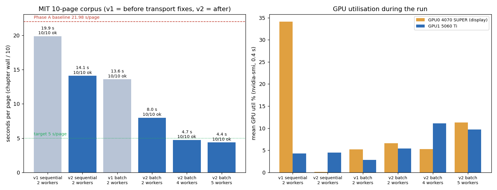

# MIT dual-GPU throughput: diagnosis, two transport bugs, worker layout (2026-10-25, #1119)



**Goal (developer, 2026-10-25):** use both GPUs at full efficiency and cut translation time for batch and
single-page use, researching Strata-xeno (`D:/Github/Strata`, `C:/Strata-exp`) as the engine. **Reading taken:**
Strata-xeno is studied as a *reference design* for MIT's serving layer, not swapped in as MIT's runtime (see
"Strata-xeno as the engine" below for why). Correct this if the intent was different.

## Results

10 real corpus pages (`tmp/mit_bench.py`, `MIT/result/corpus2/`), `target_lang=THA`, `deepseek-v4.1-flash` via
OpenCode Go, `reasoning_effort=low`, `MIT_PRELOAD=1`. GPU1 = RTX 5060 Ti 16 GB, GPU0 = RTX 4070 SUPER 12 GB
(display card). **v1** = before the transport fixes; **v2** = the integration branch at `b4d5d7a7`
(#1111 + #1118 + GPU-aware dispatch + queue fix + `Response` fix). One run per arm.

| arm | workers (GPUs) | requests | chapter wall | s/page | ok | GPU0 / GPU1 mean util | max VRAM GPU0 / GPU1 |
|---|---|---|---:|---:|---:|---|---|
| Phase A (handoff) | 2 (1,0) | sequential | 219.84 s | 21.98 | 10/10 | 27.8 / 3.8 % | 5591 / 4800 MiB |
| v1 sequential | 2 (1,0) | sequential | 198.69 s | 19.87 | 10/10 | 34.1 / 4.3 % | 4217 / 4958 MiB |
| **v2 sequential** | 2 (1,0) | sequential | **140.94 s** | **14.09** | 10/10 | 0.1 / 4.5 % | 4703 / 4958 MiB |
| v1 batch | 2 (1,0) | all 10 at once | 135.73 s | 13.57 | 10/10 | 5.2 / 2.8 % | 8968 / 5690 MiB |
| v1 batch | 4 (1,1,1,0) | all 10 at once | 73.77 s | 9.22 | **8/10** | 3.5 / 8.0 % | 7410 / 14220 MiB |
| **v2 batch** | 2 (1,0) | all 10 at once | **79.79 s** | **7.98** | 10/10 | 6.6 / 5.4 % | 8963 / 5040 MiB |
| **v2 batch** | 4 (1,1,1,0) | all 10 at once | **47.23 s** | **4.72** | 10/10 | 5.3 / 11.1 % | 7354 / 15008 MiB |
| **v2 batch** | 5 (1,1,1,0,0) | all 10 at once | **43.64 s** | **4.36** | 10/10 | 11.3 / 9.7 % | 11455 / 13200 MiB |

- **Single page:** 21.98 → 14.09 s/page (−36 %) from the `Response` fix alone (no new knob).
- **Batch:** 21.98 → 4.36 s/page (5.0×) with 5 workers, 10/10 pages; the ≤ 5 s/page target is met with 4 or 5 workers.
- **The "≥ 70 % mean util on both GPUs" target is not met and is the wrong target here:** GPU stages are 2–3 s of a
  page; the rest is a remote LLM call. Both cards now carry pages concurrently (GPU0 VRAM 4.7 → 11.5 GB, GPU1
  4.9 → 13–15 GB), which is what "use both GPUs" can mean while translation is remote.
- Phase A's "GPU0 27.8 %" and v1's 34.1 % were other apps on the display card: GPU0 sat at 40 % before and
  independent of MIT's request, and at 0.1–0.6 % in isolated runs.
- Gateway variance between identical configs is large (v1 vs v2 sequential differ by code *and* by time of day);
  every arm is one run, so differences under ~20 % are not claimed.

## Diagnosis — what the time was actually spent on

| finding | evidence |
|---|---|
| Worker placement was correct | worker 5004 on PCI bus 06 (5060 Ti), 5005 on bus 01 (4070 SUPER) via `nvidia-smi --query-compute-apps`; `find_executor` picks the first free worker, so sequential pages always land on GPU1 |
| GPU stages are short | one page: detection 0.33 s, OCR 1.18 s, merge 0.25 s, **translation 11.05 s**, mask 0.18 s, inpaint 0.31 s, render 0.09 s |
| The gateway is not the concurrency limit | 8 concurrent calls: 8.0 s wall, about one call's 8.5 s (`gw_probe`, toy prompt) |
| **Results took 2.5–13 s to get from worker to front** | worker `translate()` 40.4 s vs front `get_ctx` 53.7 s on one page, 15.1 vs 17.6 s on another (temporary `[DBG-1119]` probes, removed) |
| **Pages in a batch failed instantly with HTTP 500** | `batch_w4` v1: 2/10 pages at 0.07–0.08 s; front log `POST /translate/with-form/image 500` with no worker activity |
| Slow pages are reasoning runaways | same page 5×: reasoning 334–2239 tokens for ~350 content chars, `finish=stop` (new `Token split` log fields) |
| ~~`reasoning_effort` does not bound reasoning~~ **corrected below** | the `none` runs never sent `none`: `resolve_reasoning_effort` dropped it (see Corrections) |

## Changes

1. **`fix(MIT)` queue lost a waiting request** — `TaskQueue.update_event` (`MIT/server/myqueue.py`) iterated the
   live queue across `await`s; a concurrent `remove()` shifted the iterator, so a queued request vanished
   (instant 500 "User is no longer connected") and the dispatched one came back. Post-mortem:
   [`docs/reports/2026-10-25-mit-queue-lost-request.md`](../2026-10-25-mit-queue-lost-request.md).
2. **`perf(MIT)` one `Response` instead of `StreamingResponse(BytesIO)`** — Starlette iterates a `BytesIO` line by
   line; a 21.6 MB pickled Context went out as 84,489 chunks: **30.2–31.8 s vs 0.05–0.07 s** as one `Response`
   (localhost microbench). Fixed in the four worker endpoints (`manga_translator/mode/share.py`) and the two PNG
   endpoints (`server/main.py`); `test_no_bytesio_streaming.py` guards every file under `server/` and
   `manga_translator/mode/`.
3. **Token split log** — reasoning tokens, content size and finish reason per call (`custom_openai.py`).
4. **GPU-aware dispatch** (stacked on #1118) — `worker_plan.pick_free_worker` sends a page to the free worker on
   the GPU with the fewest busy workers; ties keep registration order. **Not measured in isolation:** with 10
   requests at once every worker is busy whatever the pick order, so the batch rows above do not measure it.
   It matters when load < worker count (a second concurrent page goes to the idle card).

**Tried and rejected — hedged translation request** (`MIT_TRANSLATE_HEDGE_S`): start one identical call when the
first has not answered after N s, keep the first to finish. An offline simulation on 84 real call times predicted
−17 % mean / −29 % p90 at 12 s, but real sequential runs were slower in 2/2 pairs (230 vs 199 s at 12 s; 185 vs
141 s at 15 s) and the worst page got worse (36.7 vs 27.9 s). One batch gain (43.6 → 38.7 s, 5 workers) is inside
run-to-run variance. Removed rather than kept as a default-off knob (commit `debfbb8a` on the integration branch).

## Corrections and later findings (same day)

**`reasoning_effort=none` was never sent.** `MIT/manga_translator/runtime_options.py` allowed only
minimal/low/medium/high, so `CUSTOM_OPENAI_REASONING_EFFORT=none` was dropped and the gateway used its default (heavier)
reasoning — which is why the "none" arm above was slower. Replaying MIT's real request bodies through a recording proxy:
`none` → **0 reasoning tokens, 2.3–4.8 s per call**; `low` → 36–3928 reasoning tokens, 1.6–49 s. A blind A/B on the
10 corpus pages (same OCR input, 2 runs per arm, judged per segment): `low` wins **76**, `none` **46**, ties 37. So
`none` is a real speed/quality tradeoff, opt-in; `low` stays the default. Fix: on PR #1111's branch (`none` passes
through). Gateway thinking-budget parameters (`thinking.budget_tokens`, `reasoning.max_tokens`, `thinking_budget`)
were ignored by the gateway (reasoning still 1182–2873 tokens).

**The Backend's chapter path was sequential.** `server/batch_runner.run_batch_with_callbacks` (webhook mode, used by
`Backend/src/books/mit-batch-stream.ts`) translated one page at a time, so the batch rows above (concurrent requests)
did not describe real chapter translation. PR #1122 runs independent pages one per worker when rolling context is off.
Backend path, 10 pages:

| layout | run 1 | run 2 |
|---|---:|---:|
| 4 workers, before (sequential loop) | 94.9 s (9.49 s/page) | – |
| 4 workers, PR #1122 | 34.5 s (3.45) | 26.8 s (2.68) |
| 5 workers, PR #1122 | 35.4 s (3.54) | 29.9 s (2.99) |
| 5 workers, `MIT_BATCH_CONCURRENCY=6` | 35.0 s (3.50) | 30.4 s (3.04) |

5 workers and an extra pre-staged request do not beat 4 workers on this path: it is now bound by LLM latency and
gateway variance, so 4 workers (less RAM) is the live layout.

**Also tried and rejected:** OCR chunk 16 → 64 (OCR −12–17 %, ~0.1 s/page, but 66 OCR lines changed text).

**Strata live attempt** (developer later clarified the intent was to adopt Strata's approaches, not run it): Gyro-M
with a reduced config was started twice beside the desktop under a memory watchdog and killed both times at the commit
limit (101.4 / 102.8 GB with a 10 GiB RAM cache; 93.7 / 94.4 GB with 2 GiB). Details in #1119.

**Faster single page: claude-haiku-5-5 on the Anthropic protocol (PR #1125).** Strata treats short non-interactive
requests as side requests that should barely think (`serve/think_budget.py`); the gateway ignores thinking budgets, so the
equivalent is a model that answers directly. Blind A/B on MIT's real request bodies (10 pages × 2, judged per segment by
deepseek): haiku **87**, deepseek@low **73**, ties 24; ~2.3–4 s per call (max 8.8 s) vs 1.7–36 s. E2E translation
3.9–4.8 s per page; Backend chapter path on 4 workers 23.2–31.9 s vs 26.8–34.5 s. Opt-in
(`CUSTOM_OPENAI_PROTOCOL=anthropic`, `CUSTOM_OPENAI_MODEL=claude-haiku-5-5`); the live `.env` is unchanged because
pricing is the developer's call.

**Workers die with the front (#1118).** Strata's `winjob.py` puts its engine in a kill-on-close job. MIT's front now
joins such a job before spawning (`server/win_process.py`), so a force-killed front leaves no worker on its port
(verified: killing only the front's pid left 0 worker processes). A first version that assigned only the venv launcher
raced and left an orphan. EcoQoS impact is unmeasured (the first A/B opted out only the launcher).

**In-worker batch slots** (one worker, N pages, one model copy — Strata's `BATCHING.md`) are blocked by a shared
translator config (`custom_openai.py:138`, `parse_args`); parked as #1123.

## Strata-xeno as the engine

| question | answer | source |
|---|---|---|
| Can Strata's engine run MIT's pipeline? | No: it is a C++/CUDA (ggml) runtime for one MoE LLM; MIT's detection/OCR/inpaint are PyTorch vision models | `D:/Github/Strata` README, `engine/`, `serve/` |
| Could Strata be MIT's *translator*? | Protocol yes (`/v1/chat/completions`, image parts accepted: `serve/frontend.py:155`). On this PC, no | below |
| Speed vs the current gateway | Strata decode 51–72 tok/s single stream; batch slots +31–39 % total | **Strata README / `docs/BATCHING.md` / `strata-gyro-m-d2x.json`, not rerun here** |
| | gateway measured ~85–100 tok/s per stream, flat to 8 concurrent | measured here (`gw_probe`, real-page token logs) |
| Memory | free RAM with the MIT stack up: **12.9 GB of 47.7 GB** (each worker ~4.6 GB private); Strata's fork peaks at a 23.7 GiB working set and Gyro-M places 6400 MiB of experts on the 4070 | free RAM measured here; Strata figures from its README/config |

**Local Strata measurements on this PC** (from the engine's own logs, `D:/Github/Strata/strata-gyro-m-d2x.log` and
`strata-swift-capacity.log`): Gyro-M D2x decodes **47.5–60 tok/s** with **46.8 GiB private commit**; the capacity profile
(12 GiB RAM cache + NVMe) decodes **33.8 tok/s** with **35.6 GiB**. With MIT stopped and the developer's apps open the PC
had **17.5 GB available and 72.4 of 90.5 GB committed** (measured 2026-10-25), so neither profile can start beside the
current desktop, let alone beside MIT workers (D2x also fills both cards: 8000 MiB expert cache on the 5060 Ti, up to
12288 MiB on the 4070). **Projection, not run:** at ~700–1000 completion tokens per page, translation would take ~12–20 s
per page on Gyro-M against 8–11 s on the gateway, and a 10-page batch would decode serially (or +31–39 % with batch slots)
instead of 4–5 pages in parallel. A live MIT-on-Strata run needs ~30 GB of RAM freed first.

So on this 48 GB, 16 + 12 GB PC Strata cannot run beside a multi-worker MIT, and its single-stream decode is
slower than the gateway MIT uses now. What transferred is its **serving layer**: replicas behind one front with a
lowest-load router (`serve/replicas.py` → `pick_free_worker` and the 4–5-worker layout), batch slots
(`docs/BATCHING.md` → several pages in flight). The two largest wins (the queue race and the `BytesIO` stream)
were MIT bugs the Strata study did not point at; they came from tracing where each page's seconds went.

## Recommended configuration

```env
MIT_WORKERS=5
MIT_WORKER_GPUS=1,1,1,0,0   # 3 on the 5060 Ti (~13-15 GB peak), 2 on the 4070 SUPER (~11.5 GB peak, display card)
```

Drop to 4 workers (`1,1,1,0`) when the display card is busy with other GPU apps; 5 workers leave ~0.8 GB on GPU0.

## Not measured / open

- Dispatch order in isolation (needs a run with fewer concurrent pages than workers).
- Repeated runs per arm (gateway variance).
- Translation quality: no change is expected (no prompt/model change), not re-judged.
- Single-page floor is now the LLM call (~10 s mean, long tail from reasoning runaways). Next levers, not done:
  a faster model (quality decision), speculative mask/inpaint overlapped with translation (the post-translation
  region filter at `manga_translator.py:1722` decides the mask, so this is core-seam work), in-worker batch slots
  sharing one model copy (VRAM, not speed, limits workers today).
