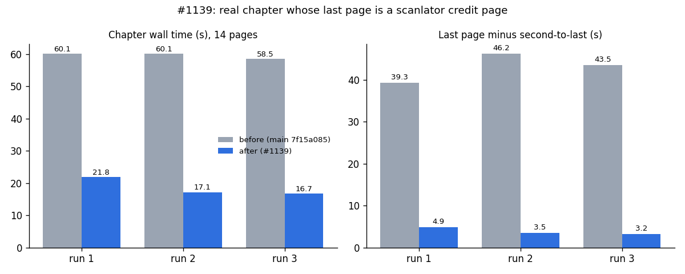

# #1139 — credit pages re-translated by guards that can never pass

**Setup:** live MIT (2 workers, `MIT_WORKER_SLOTS=5`, gateway `claude-haiku-5-5`), with the Backend's real config
(`buildMitConfig`). The chapter is the developer's real 14-page chapter; its last page (`p13`) is a Setsuscans
donation page with coin names, wallet addresses and URLs. Before = `main` 7f15a085, after = `fix/mit-untranslatable-retry`.

| | before | after |
|---|---|---|
| credit page alone: LLM calls | 4 / 8 | 1 / 1 / 1 / 1 |
| credit page alone: translation stage | 19.0 / 35.3 s | 6.4 / 7.0 / 3.4 / 6.5 s |
| credit page alone: request | 24.4 / 40.3 s | 15.3 / 12.0 / 11.2 / 11.3 s |
| story page (same chapter): request | 4.4 / 4.3 s | 4.4 / 4.5 / 4.7 / 4.6 s |
| 14-page chapter wall | 60.1 / 60.1 / 58.5 s | 21.8 / 17.1 / 16.7 s |
| last page minus second-to-last | 39.3 / 46.2 / 43.5 s | 4.9 / 3.5 / 3.2 s |

The developer's live log (before) shows the credit page's translation stage at 33.8 s, the slowest of 169 (median
3.3 s).

**Replay (no LLM):** old and new guards were run over every translation in the session logs.
- Page ratio: across 540 page translations, 42 verdicts change, all of them a credit page going fail → pass. No
  verdict gets stricter. Pages answered in English still fail.
- Untranslated-word guard: across 3,903 segments, 60 are no longer flagged. All 60 are the `Paypal` / `Patreon`
  lines of the credit page.

**Render:** the after-fix render of the credit page was checked by eye. Its sentences are in Thai, and the
addresses, QR codes and URLs are untouched. The image is not committed, because it is a third-party page.

**Defect → evidence:** the symptom ("the last page of a chapter finishes far later than the one before it") is
gone. The gap fell from 39–46 s to 3–5 s on the chapter that showed it.
