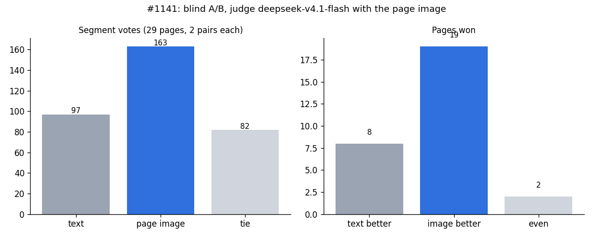

# #1141 — the translator sees the page image: blind A/B

**Setup**
- **Requests:** real request bodies captured from live MIT (Backend `buildMitConfig` config, haiku on the Anthropic
  protocol) through a recording proxy, one page at a time. They cover 29 story pages from 6 chapters the developer
  translated.
- **Arms:** each body was sent twice as is (text) and twice with the page image in front of the segments (image,
  JPEG with its long side capped at 1568 px).
- **Judge:** deepseek-v4.1-flash, a different model family, with the page image. It picked X, Y or tie per segment,
  and X/Y order was randomised per pair.

| | text | page image |
|---|---|---|
| votes (ties 82) | 97 | **163** |
| pages won (2 even) | 8 | **19** |
| round 1, 12 pages | 47 | 50 |
| round 2, 17 pages | 50 | 113 |
| input tokens per page (median) | 1,111 | 3,346 |
| translation call (median) | 2.05 s | 3.15 s |
| real 14-page chapter wall | 18.1–22.7 s (3 runs, #1140) | 16.6–23.7 s (5 runs) |

**Read by hand:** the image fixes OCR slips (`HAIMIYAT -SENPAIS RINE...`: ไฮมิยัต -รุ่นพี่ริเนะ... → ไลน์ของรุ่นพี่ไฮมิยะ…), gives a
male speaker ผม/ครับ instead of ฉัน, and reads the scene (`THATS NOT IT`: ไม่ใช่คำนั้น → ไม่ใช่แบบนั้นหรอก). It was worse
twice: a misspelt name (ไห่มิยะ), and once คะ for a male speaker.

**Limits:**
- There was one judge model and no human rater.
- The page-level sign test is p = 0.052.
- Round 1 alone was even; the effect comes from round 2.
- Translation sampling varies run to run, so one render can still pick ฉัน.

**Live check:** with the feature on, the logged prompt size went from ~1.1k to 2.9–3.2k tokens, so the image is
attached. No model rejected it, and a rendered page was checked by eye. The page images are third-party and are not
committed.
