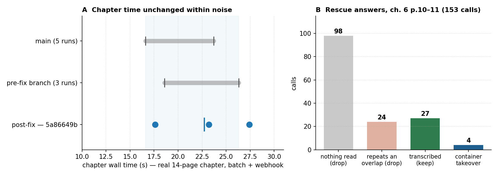

# Phase 0 — five defects on Haimiya ch. 6, and what fixing them costs

**Setup**
- **Corpus:** *Haimiya-senpai wa Kowakute Kawaii* EN ch. 6 — the developer's own 14-page chapter (the last page
  is the scanlator credit page). Pages 2, 10 and 11 carry every defect below.
- **Live stack:** MIT `:5003`, two workers on two GPUs (`MIT_WORKERS=2`, `MIT_WORKER_GPUS=1,0`, 5 slots each),
  translator `claude-haiku-5-5` on the Anthropic protocol (`CUSTOM_OPENAI_PROTOCOL=anthropic`), OCR rescue on
  (`ocr.vlm_rescue`). Branch `fix/mit-phase0-ch6` at `5a86649b`.
- **Two paths, measured separately:** `/translate/with-form/patches` is what the Reader calls, so the before/after
  of a defect is read from its regions; `/translate/with-form/patches/batch` + webhook is the chapter path, so the
  wall time comes from there.

## The five defects

| # | Where | Symptom the reader saw | Cause | Fix |
|---|---|---|---|---|
| #881 | p10, p11 | `I'm glad.` and `Kurose -kun, you...` never rendered — lines simply missing | the rescue call carried no `x-opencode-session` header (400 MissingSessionID: **0 of 925** boxes rescued in three session logs); the 48 px OCR dropped a guessed box read below the prob floor before the rescue saw it; the rescue asked for a *target-language onomatopoeia*, so hand-lettered dialogue came back empty | the rescue now transcribes, on the translator's own Anthropic transport and model; guessed boxes (det_sfx, empty-balloon / ink-cluster placeholders) stay unread for it; `resolve_rescue` keeps / drops / lets a container replace the lines it repeats; dash-and-ring reads are not sent; every outcome is logged |
| #1144 | p2 | a whole page came back with the original art and **nothing** — and stayed that way for a week | the translator echoed the source twice, every line dropped as "identical to original", `translate_patches` returned success with 0 patches, the Backend cached `{"patches": []}` for 7 days | `stage_runner` records a failed stage per request (`begin_page` / `failed_stages`); `text_layer.page_failure` = a stage failed, or ≥3 lines echoed; `translate_patches` raises, both delivery paths turn that into a page error, and the Backend never caches an error |
| #1145 | p2 | `(ไม่มีข้อความ)` ("no text") was drawn onto the art | OCR junk from a vertical "CHAPTER 6" label came back as a note *about* the line | `region_filter.is_translator_note`: an answer wholly in brackets while the source is not is dropped as a translator note; a source that is bracketed keeps its brackets |
| #1146 | p2 | two speeches interleaved into one sentence | DBNet boxed `AND I DON'T` (left balloon) and `HOME AFTER` (right balloon) as **one** line | `detection_postproc.split_cross_balloon_lines` cuts the line where it leaves the first balloon, before OCR; lines inside one balloon are untouched |
| #1147 | p2, p10, p11 | caption/ink rescue never ran on narration-only pages; and none of it was visible in the log | `merge_empty_balloons` returned early when the balloon YOLO found nothing; `utils.log.Filter` only let `manga-translator.*` through, silencing every `manga_translator` logger — which is why #881 and #1139 went unseen | no early return; the filter lets our own loggers through |

## Evidence, live (3 runs each)

`/translate/with-form/patches`, pages 10 and 11:

| source line | run 1 | run 2 | run 3 |
|---|---|---|---|
| `I'm glad.` | ดีใจนะ | ดีใจด้วยนะ | ดีใจด้วยนะ |
| `Kurose-kun, you...` | คุโรเสะคุง... เธอนี่นะ... | คุโรเสะคุง เธอ… | คุโรเสะคุง เธอนี่.. |

- `I'm glad.` was recovered on **all 6** page-9 runs in the log (three earlier ones included).
- The rescue log now says what it did: `[OcrVLM] transcribed rescue region "" -> "I'm glad." (keep)` and
  `… "14" -> "Kurose-kun, you..." (takeover)`.
- **No** `400 MissingSessionID`, **no** `transcription unusable`, **no** `rescue paused` anywhere in the
  9,370-line log of the verification session.

## What it costs

Chapter wall time, same 14-page chapter, same script, three runs on the fixed branch:

| branch | runs | chapter wall |
|---|---|---|
| `main` (`e679c128`) | 5 | 16.6–23.7 s |
| pre-fix branch (`09cc556c`) | 3 | 18.6–26.3 s |
| **fixed (`5a86649b`)** | **3** | **17.6 / 23.2 / 27.4 s** (median 23.2) |

Every run returned 14/14 pages with no page error. One of the three runs sits 1.1 s above the pre-fix maximum —
that is run-to-run API noise, not a regression: the added work is one transcription call per guessed box, and
those calls are prefetched concurrently.

After the review pass (ADR 037), pages 10–11 were re-run twice on the fixed tree and the chapter benchmark twice
more: `I'm glad.` and `Kurose -kun, you...` still come back, and the chapter path still returns 14/14 (the added
work there is bookkeeping only — a page that fails now answers 422 instead of 500, so the Backend stops retrying
it).

The rescue is still the expensive part, and it is now measurable (panel B of the chart): on pages 10–11, 153
transcription calls produced 31 usable answers (27 kept, 4 container takeovers), 24 were dropped as the #278
phantom over a bubble they just repeat, and **98 read nothing at all** (single kana, `I`, `O`, balloon arcs on
art). Those 98 are the remaining waste — each is a vision call that returns `NONE`; a cheaper pre-gate is the
obvious next step, not a correctness problem.

## Limits

- One chapter, one series, one translator model. The defect shapes are general (a missing header, an echoed page,
  a bracketed note, a cross-balloon line, a silenced logger) but the counts are this chapter's.
- The 14-page chapter has no page that legitimately contains no text, so the #1144 threshold is only exercised by
  the echoed p2 — the `≥3 echoed lines` cut-off is a heuristic, not a proven boundary.
- The rescue's answers are model output: a run can still transcribe a line slightly differently, and the container
  takeover needs the transcription to repeat every line it swallows.
- Manga pages are third-party: only the chart is committed, never the pages.
