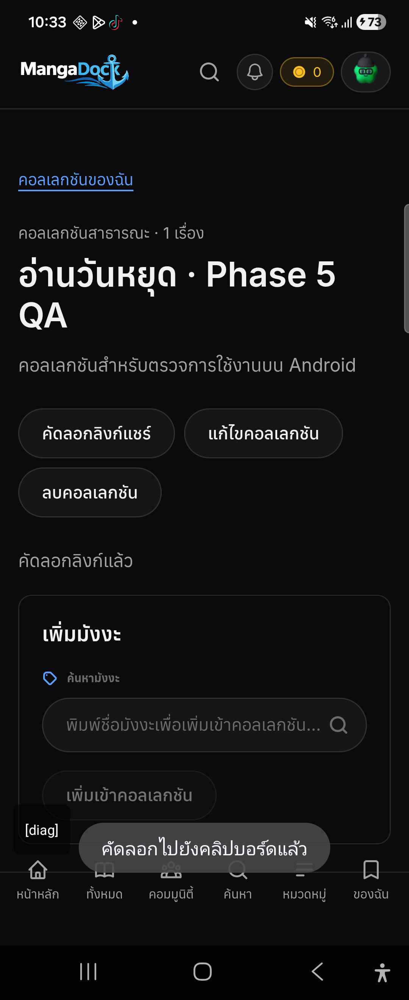
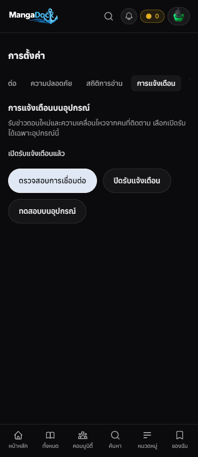

# Hybrid Phase 4–5 continuation — 2026-11-09

ผู้ใช้อนุญาตให้ใช้ scope **hybrid Phase 4–5 ข้าม payment** แทน Cache Phase 2
ใน `CLAUDE_BRIEF.md` แล้ว รอบนี้รวมงาน Push แต่ยังไม่มี provider configuration
สำหรับตรวจรับการส่งจริง จึง **ยังไม่ปิด Phase 4–5 ทั้งระบบบน production**

## Source and changes

- Worktree: `C:/Users/woral/md-hybrid-phase5-20261026`.
- Branch: `feat/mobile-hybrid-phase5-20261026`, HEAD `7fb8fc79`;
  implementation `ae6d2289`, hybrid Phase 4 base `69badd5f`.
  `git ls-remote` confirmed the two hybrid branch heads during this session.
- Kept the existing React Native CLI/WebView architecture. The accepted hybrid
  Phase 4 product-parity scope remains the reference; no capture/overlay or native
  screen migration was introduced.
- `Frontend/app/lib/hybridPushController.ts`: OS permission now has the same
  bounded, abortable wait as token acquisition. Logout/account changes release
  the operation queue even when the OS permission promise has not resolved.
- `Mobile/src/hybridPush.ts`: recheck the account revision after notification
  channel creation and ownership-marker storage, before permission/token work.
- Added three regressions in the corresponding web/native test files. The web
  pending-permission and native pending-storage regressions failed on the old
  implementation and passed after the fix. Native channel cancellation is also covered.
- `Mobile/android/app/build.gradle`: version `1.2.0-phase5-beta.3` / code `10`.
  Existing signing/auth guards and push-off default were preserved.
- `Mobile/scripts/phase5-device-qa.cjs`: optional `PHASE5_DISPLAY_ID` captures
  foldable screenshots through a device file/pull, keeping display warnings out of
  PNG bytes; device loss during final metadata collection no longer hides the
  original test error or prevents writing a result file.
- Updated `Mobile/docs/2026-10-26-hybrid-phase5.md` with this scope/resume pointer
  and both workspaces' `DONE.md` with the continuation record.
- Preserved all pre-existing tracked/untracked changes. No commit, push, database
  migration, provider change or production deployment was performed.

## Verification

| Check | Result / boundary |
|---|---|
| Mobile Jest | **96/96**, 18 suites; baseline was 94 |
| Mobile TypeScript / ESLint | Pass; 0 errors, one existing inline-style warning |
| Web push controller | **17/17**, Bun 1.4.4 |
| Web auth/cache regressions | **12/12** |
| Focused web ESLint | 0 errors; two existing unused-argument warnings in the test fixture |
| Backend build + Phase 5 SQL/HTTP/worker | **19/19**, real migrations in isolated PGlite; substituted provider/Redis boundaries |
| Backend complete Jest | **1,179/1,179**, 114 suites, Node **v22.23.4**, CI config; isolated test environment |
| Frontend production compilation / types | Pass via `node scripts/phase5-local-qa.cjs build` |
| Browser through actual Next proxy | **9 groups**, 320/390/768/1024/1280 px; [results](browser-results.json) |
| Android live-target / isolated-QA assembly and vital lint | Both pass; ARM64 + x86_64, target SDK 36, QA signing |
| APK verification | Both signatures valid; package/version/ABIs checked; [metadata](apk.json) |
| Flip4 feature acceptance | **10 flows**, 24 native-header-bearing feature requests; [results](physical/results.json) |
| Flip4 shell/lifecycle acceptance | **4 flows**; [results](physical/shell-results.json) |

Browser and phone acceptance use synthetic Auth/catalog fixtures and **actual**
Next proxy → Nest controllers/services → Supabase client → isolated PostgreSQL
migration SQL. Phone APK/WebView, clipboard, native identity, Android intents,
process restart, rotation and retry UI are real. No real account, remote push,
payment, public post or production collection was written by these suites.

The browser Push group covers no startup prompt, denial, acknowledged opt-in,
preview, recipient-scoped tap, reload and opt-out with a substituted OS boundary.
The Android suite's `excluded: [payment, notifications]` describes that suite's
coverage, not the owner's current scope: OS push is still an open Phase 5 gate.

Flip4: `SM-F721B`, Android 16. Confirmed follow/unfollow → feed, 20→25 pagination,
personalized feed, collection CRUD/search/add/remove, public link/guest read,
privacy revocation, clipboard, background/reload, warm/cold deep links, stable
identity after restart, landscape and real network failure/native retry/recovery.
Rotation/network overrides were restored by the suite. No uninstall/data clear.
The isolated APK's installed SHA-256 matches its local artifact.

No new MIT translation, real social-provider login, creator/staff/MFA acceptance,
FCM/APNs delivery, live Redis recovery, iOS or store-signing acceptance is claimed.
Historical reader/MIT evidence remains in the October reports and is not relabeled
as a fresh result. Broad Frontend baseline debt was not rerun or claimed fixed.

## APKs

Both are local QA/debug-signed artifacts, **push disabled**, not store releases:

- Live target: `Mobile/build/phase45-20261109/hybrid-phase5.apk`,
  `https://hayateotsu.space`, SHA-256
  `65e3e5e335d35eb24adfc3ea452f93a039d346707eb2e43ebea1433452c8ed81`.
- Isolated test target: `Mobile/build/phase45-20261109/hybrid-phase5-local-qa.apk`,
  `http://127.0.0.1:4016`, SHA-256
  `8ee061f9ddf3d84726ee9ede1ba10825a8a13d683702339133530fb0be5242d4`.
  Requires the loopback QA services and `adb reverse`; do not distribute as a live app.
- Version/package/size for both: `1.2.0-phase5-beta.3`, code `10`, `com.mobile`,
  48,264,958 bytes. Final live-target APK was reinstalled on Flip4 without clearing
  data; explicit install session `1275920733` committed with `Success`. Installed
  SHA-256 matches the live artifact. Launched it and observed the actual WebView
  at `https://hayateotsu.space/`, document `readyState: complete` and a populated
  homepage. [Installation record](installation.json), [WebView observation](physical/live-webview.json),
  [original phone screenshot](physical/16-live-target.png). This confirms the
  installed endpoint, not production Phase 5 feature acceptance.

## Observed production gate and concrete rollout order

Read-only probes on 2026-11-09 returned **404** for:
`https://hayateotsu.space/feed`, `/collections`, `/settings/notifications` and
`/api/proxy/feed`. Installing an APK does not deploy these server-rendered routes.
No live schema check was made in this session; October's missing-schema evidence
must not be treated as a current inspection.

To complete acceptance after the team supplies its deployment target/workflow:

1. Review this exact source tree and the existing migrations. Inspect the current
   schema and take a verified database backup before any migration. The migrations
   create tables and are not blanket-safe to rerun against an already-migrated DB.
2. Use the team's database workflow for
   `Backend/migrations/2026-10-24-phase5-retention.sql`, then
   `Backend/migrations/2026-10-24-phase5-push.sql`. Keep
   `PUSH_DELIVERY_ENABLED=false` through initial rollout.
3. Deploy the compatible Backend and Frontend together, then verify the four
   missing destinations and real-account ownership/public-private behavior.
4. Use the **existing** EAS/Firebase project for `com.mobile`; supply external
   properties / `google-services.json` paths without committing credentials.
   Build with configured push enabled; verify permission, remote delivery/receipts,
   foreground/background/cold tap, token rotation, logout/account switch and offline
   cleanup on a real test recipient before enabling server sending.
5. Complete the outstanding non-payment Phase 4 role/security fixtures and
   release-signing gates before a full release claim. Payment remains excluded.

No cloud project, account or production resource was created as a substitute for
missing team configuration. Deployment/migration approval must refer to the
reviewed source, target, backup and rollback plan; none has been executed here.

## Backup / rollback / experiment ledger

- Source backup: `C:/Users/woral/md-hybrid-phase45-backup-20261109`, covering the
  changed existing source/test/version files, the pre-existing device QA script
  and `DONE.md`. Restore only the affected files from these copies after checking
  for later user edits; do not reset/clean the dirty worktree.
- APKs have the same code/signing and preserve data on `adb install -r`. Returning
  between live/isolated targets uses the matching immutable artifact; no downgrade
  or data-clear operation is required. Existing native app packages were untouched.
- Production rollback, if later approved: disable sending/stop new push workers,
  restore previous compatible web/API revisions, preserve newly written collection
  and outbox data, and use the verified DB backup/reviewed recovery procedure if
  schema recovery is actually required. Do not drop tables as an automatic rollback.
- Initial backup under `Mobile/build/` was picked up by Jest as a duplicate suite;
  moved it outside the repository before final validation. The extra missing-module
  error was a backup-layout error, separate from the two reproduced product failures.
- Two emulator attempts lost ADB with `error: closed` / `device offline`. Windows
  Application events identify `qemu-system-x86_64-headless.exe` crash
  `0xc0000005` (unknown faulting module). No emulator acceptance is claimed and no
  application-source workaround was made for this host crash. Raw Windows/Android
  build evidence remains under `Mobile/build/phase45-20261109/`.
- Flip4 installation initially waited several minutes, then returned `Success`;
  cause of delay is unconfirmed. No system install session was abandoned.
- Returning from isolated QA to the live APK also waited. Stopped only the owned
  ADB install client after transfer; direct `pm install -r` subsequently returned
  `Success` and the live hash was observed. At the owner's explicit retry request,
  a fresh session used install-create/write/commit and again returned `Success`.
  One CDP inspection reset while that installation replaced the process; after
  commit, relaunch/reconnect verified the final live URL and checksum. No security
  settings, verifier controls, signing checks or system install sessions were changed.
- Build warnings: existing SDK XML/tooling mismatch, deprecated Kotlin/Gradle APIs,
  first-build daemon Metaspace exhaustion warning and Next workspace-root warning.
  Builds finished successfully; no lint/security/build guard was disabled.

All captures are original browser/ADB PNGs. They were not generated or retouched.
