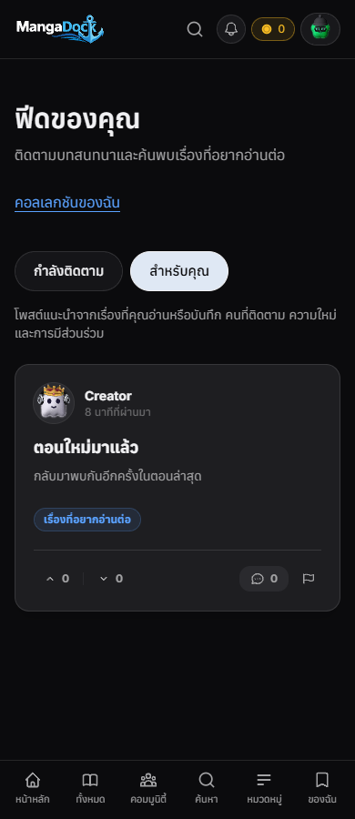
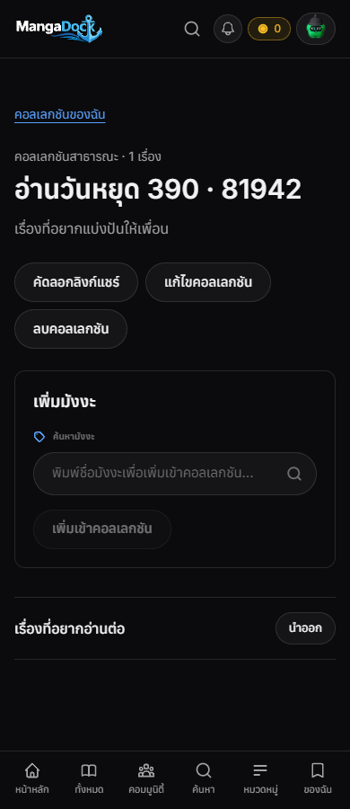
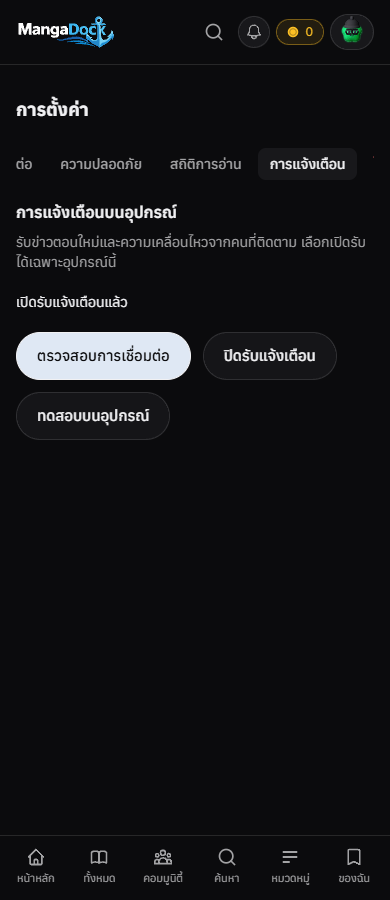
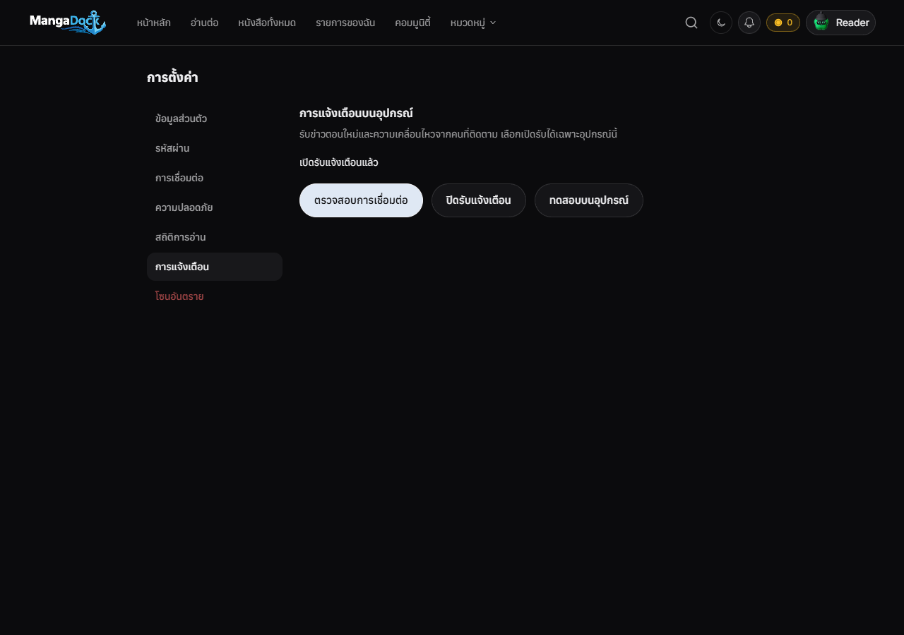

# Hybrid Phase 5 QA — 2026-10-26

Source branch: `feat/mobile-hybrid-phase5-20261026`, base hybrid Phase 4
`69badd5f`. [Implementation and resume point](../../../Mobile/docs/2026-10-26-hybrid-phase5.md).

## Browser acceptance

The actual production Frontend build renders at **390 and 1280 px**. Final
feature HTTP requests traverse the **unchanged Next proxy**, real Nest
controllers/services and the migration SQL in isolated PGlite. Synthetic
Supabase sessions and auxiliary catalog/profile responses are fixtures. Android
permission/token/tap APIs are substituted at the bridge boundary. No real
collection, follow, payment, notification read or remote Expo send is performed.

[Machine-readable results](browser-results.json) cover:

- Following/personalized mode switching and failed load/retry.
- Collection create, edit, add/remove manga, public share, guest read, private
  access revocation and deletion.
- No startup permission prompt; permission denial and retry; durable device
  registration acknowledgement; local preview; wrong-recipient tap rejection;
  accepted tap navigation; page reload; opt-out.
- Actual navbar logout removes the push binding **before** the Supabase logout
  request. Viewports have no horizontal overflow and no page errors.

## Source/native checks

| Check | Result |
|---|---|
| Mobile tests/types | 91/91, 17 suites / pass |
| Web push controller | 16/16 |
| Auth/cache regressions | 12/12 |
| Backend SQL/HTTP/worker | 18/18; build passes |
| Frontend build/types/focused lint | pass |
| Broad Frontend | 510 pass, 8 fail, 2 errors; same failures/errors reproduced on base (494 pass) |
| Backend full CI on Node 22 | 114 suites / 1,179 tests pass; Node 26 run exposed timer teardown incompatibility |
| Local CI-pinned Bun 1.3.14 | stopped after stalling in existing `reviewsFetch.test.ts`; no green CI claim |
| Android QA release/vital analysis | pass, push disabled |
| Enabled build without EAS/Firebase | correctly rejects missing configuration |

The APK is an internal QA artifact. Installation alone continues to load the
public site's deployed UI until compatible web/API services and database
migrations are deployed. Remote OS Push, release signing and production Redis
acceptance remain pending.

APK size/hash/ABIs: [artifact metadata](apk.json). The multi-ABI QA APK installs
on the Android 16 emulator and starts its WebView without native/JS crashes.
[Startup evidence](emulator-smoke.json) records **Cloudflare 1033** on the deployed
public site; this is not a successful public product-flow check. An ARM64 copy
was also installed over Phase 4 on Z Flip4 without uninstalling or clearing data.

Final web ownership-recovery additions have unit/type/build coverage. The local
Next restart with an environment override was rejected by automatic approval
review (no detailed reason supplied), so browser results are the preceding
successful actual-proxy run. No attempt was made to bypass that rejection.

## Rendered UI

All accounts and content in these browser screenshots are synthetic QA fixtures.

ภาษาไทย: ผล browser เป็นเว็บ production build จริง ผ่าน Next proxy และ SQL จริง
ในฐานข้อมูล QA แยก แต่จำลองบัญชี/catalog และขอบ OS จึงไม่ใช่ผลรับ Push จริง
หรือผลตรวจรับฐานข้อมูล production
