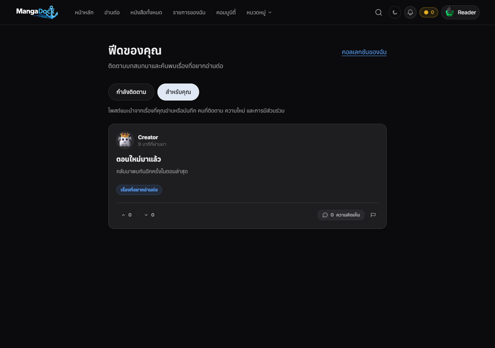
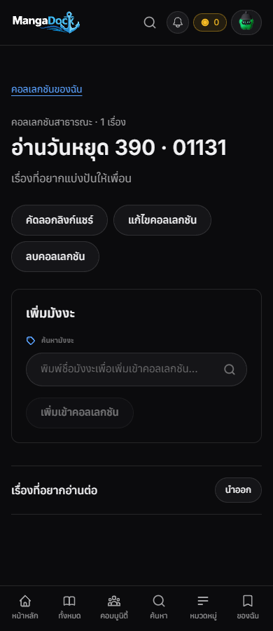

# Phase 5 implementation and local acceptance — 2026-10-24

Branch: `feat/mobile-phase5-push-20261023`, continuing `e9336f8`. Workspace: `C:/Users/woral/md-phase5-mobile`.

## Delivered source

| Area | Behavior |
|---|---|
| Following feed | `GET /feed?mode=following`; live posts by followed accounts, newest first, stable ID tie-break, votes and live-comment counts |
| Personalized feed | `GET /feed?mode=personalized`; database ranking before pagination, using followed authors, own favorites/history/series/collections, engagement and age |
| Collections | `/collections` and `/collections/:id`; create/edit/delete, search/add/remove manga, private by default, public URL copying and guest read |
| Authorization | Auth-derived owner, owner-scoped mutations, visibility and item read in one statement, no direct anon/authenticated table or server-RPC access |
| Push contract | Authenticated PUT/DELETE `/notifications/push-devices`; durable acknowledgement; owner/device/token cleanup; GET/PUT `/notifications/push-preferences` |
| Push delivery | Transactional inbox/outbox on follows and local version publication; independent Redis dispatch; database leases; bounded retry, dead-letter state, delayed Expo receipts and binding-scoped invalid-token removal |

## Validation

- `cd Backend; npm run test:phase5`: **18/18** integration cases (11 PostgreSQL, 3 real Nest HTTP, 4 worker/provider-boundary cases). PGlite executes the actual migrations/functions on an isolated existing-schema fixture. Supabase's real HTTP client is used against the fixture transport. Expo and Redis are simulated; no push or external message is sent.
- Backend affected-area regressions: **96/96**, five Jest suites (auth, users, follows, forum and write-ID errors).
- Backend build, lint on changed/new TypeScript: passed.
- Frontend production build, TypeScript and lint on the new feature files: passed. The existing community/mylist files have unrelated lint findings outside the added navigation links.
- Browser acceptance: [results](browser-results.json), Chrome headless at **390 px and 1280 px**, actual production UI. Collection CRUD, manga selection, public guest read, privacy revocation, copy link, deletion, following/personalized tabs, failure/retry and horizontal overflow passed; no page errors. Synthetic sessions and auxiliary catalog/profile responses are used. Feature requests are forwarded by the browser harness to real Nest controllers/services + the isolated PostgreSQL database; this does not certify production networking or the unchanged Next proxy.
- Existing Mobile: **254/254** tests and TypeScript passed; native source and push rollout flags are unchanged.
- Broad regression limits: full Backend Jest stopped in the unchanged `books/mit-batch-orchestrator.service.ts` timer path (`ReferenceError: setTimeout is not defined`). Full Frontend Bun run reported **492 pass, 8 fail, 2 errors**, including existing docs SSR tests. Neither whole suite is claimed green; these failures are outside the new feature paths. No existing production/test files in those areas were changed.

## Review

Applied the scrutinize workflow: checked the smaller alternative (reuse existing follows/cards/auth/Expo), then traced Web entry → session-bound request → AuthGuard → SQL visibility/ranking, and native registration → event trigger → durable outbox → Redis pop → database lease → provider ticket/receipt → binding-scoped cleanup. Public reads explicitly bypass personalized caches and send `Cache-Control: no-store`; authorization and quotas are exercised at database and real HTTP boundaries. No remaining blocker was found for the locally verified source scope. Production migration, transport, native-device and housekeeping acceptance remain the release gates listed below.

## Rendered output

Synthetic QA content, rendered from the production frontend build; not production accounts/data.




## Release and resume here

1. Inspect actual existing schema/types/constraints, take the normal database backup and apply `Backend/migrations/2026-10-24-phase5-retention.sql`, then `2026-10-24-phase5-push.sql` once. They are transactional migrations, not rerunnable setup scripts. The schema fixture is not a dump of production. Do not run `supabase-migration.sql` as part of this change.
2. Deploy compatible Backend and Web source. The existing Mobile push client already matches these endpoints and payload version `1`; native collection routes and feed screens are not introduced here. Web collection URLs remain usable from a browser/WebView.
3. Keep `PUSH_DELIVERY_ENABLED=false` and Mobile `EXPO_PUBLIC_PUSH_ENABLED=false` until the team's existing EAS/Firebase configuration and enabled native build are ready. If Expo enhanced security is enabled, set server-only `EXPO_ACCESS_TOKEN`.
4. Test opt-in/opt-out, new follower, local chapter publication, foreground/background/cold-start routing, account swaps, offline logout, expired/invalid tokens and receipts against a physical device. No provider account, credentials or production schema was configured in this session.
5. Enable server/native delivery only after acceptance. Add the normal housekeeping schedule for terminal outbox rows/expired devices, and validate per-node throughput on the real PostgreSQL/Redis deployment. No production load or receipt-latency percentage was measured.

Provider contract: [Expo sending and receipt documentation](https://docs.expo.dev/push-notifications/sending-notifications/). Delayed receipt success certifies handoff to FCM/APNs, not physical display. Retries after uncertain network/process outcomes may duplicate delivery. PostgreSQL `push_outbox.state = 'dead'` is the durable dead-letter record; the Redis dead list is bounded/best effort. A token/account change is rechecked at dispatch, but cannot recall a request already submitted to Expo. Registration cleanup uses the existing owner/device/token protocol, with the same-owner/same-token ABA limitation described in [ADR 033](../../adr/033-phase5-retention-and-push-delivery.md).

Operational counters, run through the team's normal private DB tooling:

```sql
SELECT state, phase, count(*) FROM public.push_outbox GROUP BY state, phase;
SELECT min(created_at) FROM public.push_outbox WHERE state IN ('ready','working');
SELECT count(*) FROM public.push_devices WHERE last_seen_at <= now() - interval '30 days';
```

Rollback: disable server/native push flags first; revert source. New additive tables can remain. If rolling back event generation, remove `phase5_follow_notification`, `phase5_chapter_notification` and `phase5_notification_outbox` triggers through the normal migration process. No destructive rollback was executed.

## Reproduce browser acceptance

Use three terminals, with ports confined to loopback:

```powershell
# Terminal 1, Backend/: real feature controllers with an isolated in-memory DB
npm run build
node test/phase5-preview.cjs

# Terminal 2, Frontend/: use a dedicated QA build, never production credentials
$env:NEXT_PUBLIC_SUPABASE_URL='https://phase5.supabase.co'
$env:NEXT_PUBLIC_SUPABASE_ANON_KEY='phase5-test-only'
npm run build
node node_modules/next/dist/bin/next start --hostname 127.0.0.1 --port 4016

# Terminal 3, repo root: Playwright installed in a separate temporary tools folder
$env:PLAYWRIGHT_MODULE='<tools-folder>/node_modules/playwright'
node scripts/phase5-browser.cjs
```

The harness requires installed Chrome, uses only loopback feature origins and fake auth, and intercepts Supabase/catalog/profile boundaries. Test fixtures are ephemeral. It does not use a developer browser/session, send Expo requests or start workers against production.

## สรุปภาษาไทย

พัฒนาต่อบน branch Phase 5 เดิม เพิ่ม Following/Personalized Feed ที่กรองและจัดอันดับในฐานข้อมูลก่อนแบ่งหน้า ทำคอลเลกชันส่วนตัว/สาธารณะพร้อม CRUD เพิ่ม/นำมังงะออกและแชร์ URL ใช้ Auth, tokens และ UI เดิม ตรวจเจ้าของจาก Backend และปิดการเข้าตารางตรง ทำ API Push ตามสัญญา Expo client ที่มีอยู่ พร้อม transaction outbox, Redis queue แยก, lease หลาย worker, retry/dead-letter และตรวจ receipt โดยยังปิด rollout

ทดสอบใหม่ 18 กรณีผ่าน, regression Backend ที่เกี่ยวข้อง 96 ผ่าน, Mobile เดิม 254 ผ่านและ typecheck ผ่าน เว็บ build/typecheck/lint ไฟล์ใหม่ผ่าน ทดสอบ UI จริงจาก production build ที่ 390/1280 px ผ่านทั้งแชร์ให้ guest และเปลี่ยนกลับเป็นส่วนตัว ภาพและข้อมูลเป็น fixture ชุดทดสอบไม่ใช้บัญชีจริง Feature API ผ่าน Nest และ PostgreSQL จริงภายในเครื่อง แต่ Redis/Expo เป็นตัวจำลอง และ browser harness ส่ง feature requests ตรงไป Backend จึงไม่อ้างรับผล production proxy/network หรือ Push จริง

ชุดรวมยังไม่เขียว: Backend หยุดใน timer ของ books ที่ไม่ได้แก้ ส่วน Frontend รวมได้ 492 ผ่าน 8 ล้มเหลว 2 errors รวม docs SSR ที่อยู่นอกงานนี้ ต้องเทียบ schema จริง ลง migration สองไฟล์ตามลำดับ deploy source ตั้งค่า EAS/Firebase และเปิด build ทดสอบก่อนรับ Push บนเครื่องจริง ไม่ได้ลง migration/deploy/ส่ง Push/สร้าง provider ใน session นี้ Native collection/feed screens, polling ตอนใหม่จาก MangaDex, housekeeping และ throughput production ยังไม่ใช่ผลที่ตรวจรับแล้ว
