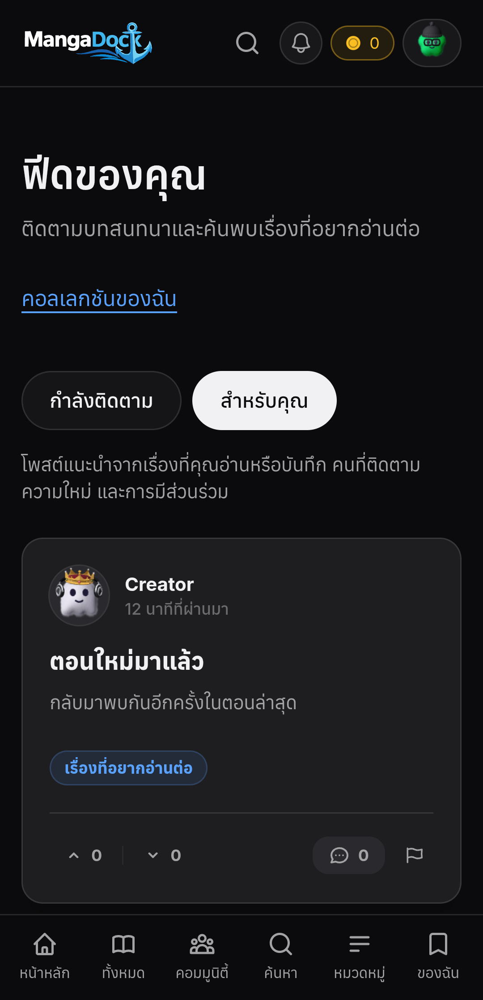
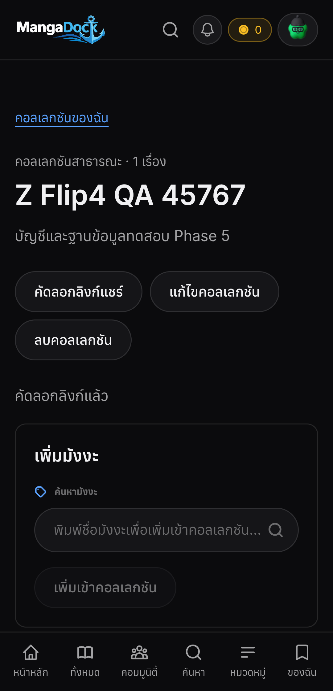
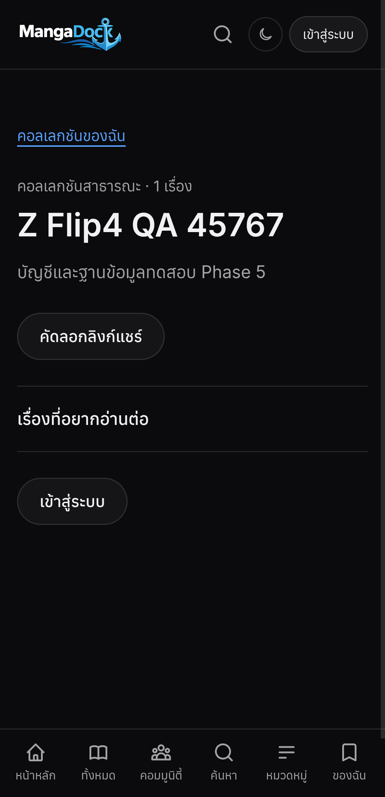
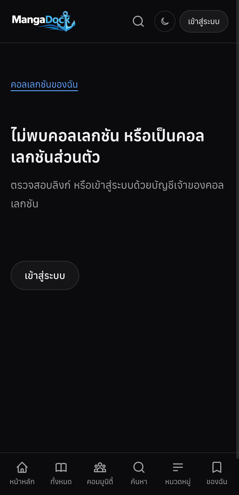

# Phase 5 — Z Flip4 device QA, 2026-10-24

Branch/source: `feat/mobile-phase5-push-20261023`, `b168975`. Device: Samsung Galaxy Z Flip4 `SM-F721B`, Android **16 / API 36**, Chrome **155.0.8059.84**. No emulator, user-agent override or emulated viewport was used. Web viewport measured **360 × 744 CSS px**, DPR **3**, five touch points.

## Result / ผลทดสอบ

**Backend is running locally at port 4001. The physical phone reached it through ADB reverse. Eight Web feature groups passed on the phone using isolated QA data. Native installation/startup/account restoration passed; remote OS push remains untested and disabled.**

เปิด Backend จาก branch นี้ที่พอร์ต **4001** และโทรศัพท์เชื่อมถึงจริงผ่าน ADB reverse ทดสอบฟีเจอร์เว็บบน Z Flip4 ผ่าน **8 กลุ่ม** โดยใช้บัญชีและฐานข้อมูล QA แยก ติดตั้งและเปิดแอป Native รวมถึงหน้าบัญชีได้ โดย session เดิมยังอยู่ **ยังไม่รับผล Push จริงและยังปิด rollout**

| Feature / ฟีเจอร์ | Physical result / ผลบนเครื่อง |
|---|---|
| Following Feed | Latest followed-author post shown / แสดงโพสต์จากคนที่ติดตาม |
| Personalized Feed | Mode switch and ranked response rendered / เปลี่ยนโหมดและแสดงผลจัดอันดับ |
| Failed load → Retry | Deliberate 503 followed by successful reload / แสดง error และกดลองใหม่สำเร็จ |
| Collection creation + manga add | Private-by-default list created and item added / สร้างส่วนตัวและเพิ่มเรื่องได้ |
| Collection edit/public/share | Visibility update and real clipboard success / เปลี่ยนสาธารณะและคัดลอกลิงก์ได้ |
| Public guest read | Guest sees contents without edit actions / guest อ่านได้โดยไม่มีปุ่มแก้ไข |
| Privacy/account isolation | Reverting to private rejects guest and other QA account / เปลี่ยนกลับส่วนตัวแล้ว guest/บัญชีอื่นเข้าไม่ได้ |
| Item/list removal | Manga removed and collection deleted / นำเรื่องออกและลบคอลเลกชันได้ |

The run recorded **23 feature HTTP requests**, with no page errors. No horizontal overflow was detected at the checked feed/collection states. [Machine-readable device results](device-results.json).

## Test boundaries / ขอบเขตผลทดสอบ

- The Web UI is the branch's real production build, rendered by the **physical phone's Chrome**. Playwright attaches through ADB-forwarded Chrome DevTools after the user opened Chrome. No personal tabs were selected or modified.
- Feature HTTP requests execute the actual Nest controllers/services and the actual migration SQL in isolated PGlite. Auth sessions, profile/catalog auxiliary responses and failure injection are controlled fixtures, and routing is intercepted. This verifies device UI + feature authorization/data logic; it does **not** certify the unchanged Next proxy or deployment networking against the shared database.
- The separate full Backend on **4001** uses the user's existing service configuration. The phone's `/status` request proves physical connectivity. Its **real configured Supabase schema is missing Phase 5**, so live feature acceptance is blocked. Nothing was migrated remotely.
- No real user collection, follow, profile, wallet, payment or notification-read state was changed. No remote push was sent. Native private account screenshots/XML are kept outside Git.

เว็บเป็น production build จริงบน Chrome ของโทรศัพท์ แต่ใช้บัญชี/ข้อมูล QA และควบคุมขอบเครือข่าย Feature API ผ่าน Nest และ SQL จริงใน PGlite แยก จึงไม่อ้างตรวจรับฐานข้อมูลใช้งานหรือ production proxy/network ส่วน Backend เต็มที่ 4001 เชื่อม config เดิมและโทรศัพท์เข้าถึงจริง แต่ schema ปลายทางยังขาด Phase 5 ไม่ได้ลง migration หรือแก้ข้อมูลบัญชีจริง และไม่ส่ง Push จริง

## Native client / แอป Native

- Replaced the installed app with the existing Phase 5 ARM64 debug APK via `adb install -r`. Package **com.mangadock.mobile**, version **0.1.0 / code 1**. Signing certificate matched the installed app; the previous APK was backed up before replacement. No app-data clear or uninstall was performed.
- APK SHA-256: `F8EB7AAE882A3E702CB600416E585B59A68D344C6B7987CE14183A972997CF2B`. Native Mobile source is unchanged since this branch's first push-client commit `e9336f8`; current JavaScript loaded from this worktree's Metro (**962 modules**).
- Observed the Native home and signed-in account screen on the device; the pre-existing session restored. Existing inbox and wallet account actions were visible. The OS push section between them was absent, as expected with `EXPO_PUBLIC_PUSH_ENABLED=false`.
- Feed and custom collections are currently **Web features**, not new Native screens. Remote push opt-in/token registration/arrival, receipts, permission denial, cold/background tap, account-switch/offline revocation and iOS remain outside the physical acceptance completed here.

ติดตั้ง APK แบบทับโดยเก็บข้อมูลเดิม ตรวจลายเซ็นตรงและสำรอง APK ก่อนหน้า เปิดหน้าหลักและบัญชี Native ได้ session เดิมยังอยู่ ส่วนตั้งค่า Push ถูกซ่อนตาม flag ที่ปิดไว้ ยังไม่มีหน้าจอ Native ของ Feed/คอลเลกชัน และยังไม่ได้รับ Push หรือทดสอบ permission/tap/receipt จริง ดู[ผล Native ที่ตัดข้อมูลส่วนตัวออกแล้ว](native-results.json)

## Blockers and work remaining / งานที่เหลือ

1. **Apply real database migrations.** Read-only preflight found missing `reader_collections`, `reader_collection_items`, `push_devices`, `push_preferences`, `push_outbox` (**PGRST205**), and `phase5_feed`/`phase5_push_due` (**PGRST202**). [Preflight evidence](live-schema-preflight.json). Verify existing schema and run the two reviewed `Backend/migrations/2026-10-24-phase5-*.sql` migrations through the normal database workflow, then test the actual proxy and authenticated API end to end.
2. **Finish Native feature surfaces** if these journeys must be available directly in the app: Following/Personalized screens, collection management/share destinations and collection deep-link handling. Browser URL sharing is already tested on the phone.
3. **Configure and enable real Push.** No EAS Project ID or Firebase Android config was found in the available settings; server `EXPO_ACCESS_TOKEN` is also unset (needed only if enhanced Expo push security is enabled). Supply the existing team's settings, build an enabled native binary, register a real device and accept remote foreground/background/cold-start delivery and receipts. Both flags remain false.
4. **Provide and validate real Redis delivery.** No Redis service is listening on the isolated QA port **6385**, and Docker/WSL Redis is not available on this workstation. Backend currently uses its documented JSON-cache fallback. Validate real multi-node dispatch, recovery, queue metrics, expiry/housekeeping and dead-letter handling after infrastructure is connected.
5. **Improve operational error reporting.** `/status` reports Redis up even though TCP to 6385 is refused; it tests `CacheHealthService` fallback without proving Redis connectivity. A missing Phase 5 RPC is currently classified by the existing exception filter as `503 SUPABASE_OFFLINE`, even though a direct read of existing `profiles` succeeds. These are observed reporting gaps, not evidence that the project/database is offline. No unrelated health/filter change was made during this QA task.

งานค้าง: (1) ตรวจ schema และลง migration จริงก่อนทดสอบ API/proxy กับบัญชีจริง (2) ทำหน้า Feed/คอลเลกชันและ deep link แบบ Native หากต้องการใช้ตรงในแอป (3) ใส่ EAS/Firebase และ build ที่เปิด Push แล้วรับผล permission/foreground/background/cold-start/receipt จริง (4) มี Redis จริงและตรวจหลาย worker/การกู้คืน/housekeeping (5) แก้ health และข้อความ error ที่ยังรายงานคลาดเคลื่อนเมื่อ Redis ไม่เชื่อมหรือ RPC ยังไม่ได้ลง

## Network diagnosis ledger / บันทึกการตรวจ Metro

Used `debug-mantra` and `diagnose`. No JavaScript debugger was attached because the failure occurs before JavaScript execution, at TCP connection establishment. The repository already has the skill tracker/domain configuration; no setup rewrite or approval was needed.

| Experiment | Observation | Conclusion |
|---|---|---|
| Same ADB reverse: phone → Backend 4001 | `/status` renders on phone | General device/reverse connectivity works |
| Host → Metro via IPv4/IPv6 | `127.0.0.1:8081` refused; `[::1]:8081` and `localhost` return `packager-status:running` | Metro is bound only to IPv6 loopback; Host-header hypothesis ruled out before HTTP |
| Phone → Metro before change | `ERR_EMPTY_RESPONSE` | Reproducible packager connectivity failure |
| Add only IPv4-loopback TCP forward to existing IPv6 Metro | Host IPv4 and physical phone both return `packager-status:running` | Confirms IPv4/IPv6 mismatch, not a bundle or device-auth bug |
| Native launch after forward | Metro bundles 962 modules; Native home/account render | Original device scenario recovered |

The small [loopback forwarder](../../../scripts/phase5-metro-forward.cjs) does not change global network configuration, install system services or expose Metro on the LAN. No app source change or dependency upgrade was required.

## Running services and resume / ระบบที่เปิดไว้และจุดทำต่อ

| Port | Purpose |
|---|---|
| **4001** | Full branch Backend with existing Supabase configuration, push sending off, isolated Redis port 6385 |
| **8081** | Expo Metro on IPv6 plus the IPv4 loopback bridge for ADB reverse |
| **4015** | Isolated feature-QA Nest server with PGlite and synthetic identities |
| **4016** | Production Web build used by the controlled device harness |
| **9225** | ADB-forwarded Chrome DevTools, used only for the user-opened QA tab |

Ignored local `.env` files were copied from the existing md4 worktree, with only local API/port/storage and disabled push overrides. No keys were printed, committed or sent to a new service. Native screenshots remain in the workstation's temporary folder. Backend and Metro are left running for the user's next test. The QA data disappears when its isolated server stops.

Reproduce with the phone connected, the existing localhost tab opened, ADB reverse for 4001/4015/4016/8081 and Chrome DevTools forwarded to 9225:

```powershell
# Required local QA servers: Backend/test/phase5-preview.cjs and Web on 4016.
# Playwright is an external testing dependency, never an application dependency.
$env:PLAYWRIGHT_MODULE='<tools-folder>/node_modules/playwright'
node scripts/phase5-zflip4.cjs
```

## Device screenshots / ภาพจากโทรศัพท์

QA accounts and collection content below are synthetic. These are physical Chrome captures, not mockups or emulator images. Captures start at the page top after keyboard/focus/scroll normalization.





